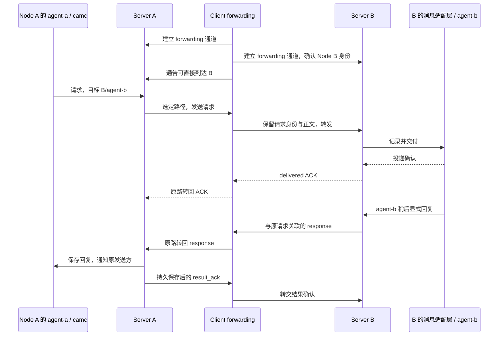

# CAM Client Forwarding Spec

日期：2026-10-18

状态：设计草案；本文列出 Client 必须实现的行为，不表示当前代码已经具备这些能力。

范围：Desktop、TUI、Mobile 连接后台的专用 forwarding 通道。架构角色、Server 单实例与 Router 先行原则以 [CAM Client / Server Spec](cam-client-server-spec.md) 为准。

## 1. 目标与职责

一个 Client 可以同时连接多个 CAM Server，并将不同来源 Server 的请求转给目标 Server 上的已注册接收端；目标是 camc agent 时，由目标机器的本机消息适配层完成投递。请求有响应时，Client 沿原请求经过的连接反向转发。



| 组件 | 必须负责 |
| --- | --- |
| 来源 Server A | 认证本机调用方、保存请求、选择 Client 路径、超时与恢复、把响应交给原调用方 |
| Client forwarding | 管理专用连接、通告直连目标、转发请求、维护回程映射、转发 ACK/响应/通道错误 |
| 目标 Server B | 校验来源和授权、持久化去重与结果、向本机接收端交付、保存回复及恢复依据 |
| 本机消息适配层 | 沿用 camc 的本机 mailbox/消息通知机制，关联本机 thread 与跨 Node 请求，把显式回复交回本机 Server |

Client forwarding 是 Client 的后台模块，即架构中的 Hub 能力，不是一个新的独立 Hub 产品。它不接管 agent registry、monitor、tmux 或生命周期；纯转发不执行 camc CLI 或拼接远程命令。

## 2. Client 必做清单

以下项目都是第一版 forwarding 的必选行为；实现和验收按编号逐项对应。

| 编号 | Client 必须做的事 |
| --- | --- |
| CF-01 | 每个 Client 后台有稳定 `client_id`；每条已认证 Server 连接绑定真实 `node_id`、Server epoch 和当前连接代次 |
| CF-02 | 每个 Server 建立独立的双向 forwarding 长连接，支持 Server 主动推送；与终端 attach/输出及 UI 请求分开 |
| CF-03 | 维护 `node_id → 已就绪连接`；同时支持多个 Server、多个并发请求及相反方向的流量 |
| CF-04 | 向已连接 Server 通告获准中继且实际直连的目标；连接变化立即更新，定期刷新，有序列号和有效期 |
| CF-05 | 接收来源 Server 请求，校验连接身份、授权、信封、目标和期限，按明确的目标 `node_id` 转发一次 |
| CF-06 | 保留业务请求的来源、目标、request ID、operation 和 params；维护与业务内容分开的回程记录 |
| CF-07 | 把目标的 ACK、pending、最终 response 与原请求关联，沿原来源连接返回；校验响应确实来自该目标 |
| CF-08 | 明确区分传输接收、消息投递确认、业务回复和路径失败；不能用 ACK 或写 socket 成功代替业务结果 |
| CF-09 | 检测断线、撤回路径、退避重连；通知可确认的失败与不确定交付，恢复时配合 Server 查询原请求 |
| CF-10 | 对每连接与总体限制帧大小、排队字节数和请求数；隔离慢连接，处理背压，限制过期回程记录 |
| CF-11 | 提供每条通道、可达目标和请求转发的简短状态/日志；默认隐藏 token、正文和其它敏感值 |
| CF-12 | forwarding 在连接后台运行；UI 页面刷新、切换 agent、关闭终端标签不能中断它；后台退出明确使路径失效 |

“支持 forwarding”表示上表全部完成，而不是仅能建立 SSH、打开端口或收到注册响应。

## 3. 专用通道与连接身份

每个启用 forwarding 的 Client–Server 对维护一条独立的双向协议连接。它可以复用既有 SSH transport，但不能借用终端 PTY、shell stdin/stdout 或终端画面作为消息通道。建议采用 WebSocket，必要时承载于 SSH tunnel；具体 transport、地址和 wire 编码在共享协议实施时确定，行为必须符合本文。

一条通道承载多个请求及 route/ACK/response 控制帧。不能为每个请求启动一次 SSH 或 camc。Client 发起连接后，Server 可以随时沿该连接发送请求。

握手必须协商协议版本、`forwarding` 能力及允许中继的 Node/operation 范围，并认证两端身份。通过配置别名连接后，仍以握手确认的 `node_id` 绑定通道；身份与配置预期不符时失败，不把别名当作节点身份。

Client 为每次新连接保存独立代次，旧连接事件不能更新或撤销新连接状态。一个后台的多个 UI 页面共享 `client_id` 和连接管理；独立 Desktop/TUI/连接后台使用各自的 `client_id`。

## 4. 可达通告：Server A 如何知道能经 Client 到 B

Client 只有在与 B 认证成功、forwarding 就绪且获准中继时，才向 A 通告 B。配置中存在 B、旧缓存显示 B、或从另一个 Server 听说 B，都不构成直连。

逻辑消息示例；字段表示必需语义，不固定最终 wire 编码：

```json
{
  "type": "routes.snapshot",
  "session_id": "client-c-to-a-7",
  "seq": 12,
  "ttl_seconds": 30,
  "reachable": ["node-b", "node-c"]
}
```

- `session_id` 绑定当前已认证通道，`seq` 在该通道内递增；A 忽略旧代次及旧序号的通告。
- `reachable` 是发给 A 的完整快照，省略的目标视为撤回；不包含 A 自身，也不包含任何间接路由。
- 建连后立即发送；目标连上、断开或授权改变时立即重发；没有目标时发送空快照。
- 正常连接也须周期刷新；刷新间隔必须小于双方协商的 TTL。示例的 30 秒不是固定默认值。
- A 按本机接收时间计算有效期，并对 TTL 设置上限；与 Client 的通道断开时立即失效，无须等 TTL。
- A 据此维护 `目标 node_id → 已授权 Client 连接集合`。同一个 B 可有 C1、C2 两条候选路径，选路归 A。

Client 不交换或宣告传递路由。第一版仅支持 `A → 一个 Client → B`。

## 5. 请求与回程：Client 如何转发

共享协议至少需要以下逻辑消息；字段应复用总 Spec 的请求/响应信封，避免建立另一套业务 API。

| 逻辑消息 | 用途 |
| --- | --- |
| `routes.snapshot` | 当前通道的直连可达完整快照 |
| `forward.request` | 转发原业务请求，内含总 Spec 的 request 信封 |
| `forward.query` | 查询指定目标上原来源身份/request ID 的处理状态或结果，不重新执行业务 |
| `forward.ack` | 携带原来源身份与 request ID、ACK 产生端身份及阶段；`received` 可逐跳产生，`delivered` 仅由目标产生 |
| `forward.response` | 携带原来源身份及总 Spec 的 response；可为 pending、ok、error、unknown |
| `forward.error` | 路径/通道错误及交付是否确定；不冒充目标的最终业务响应 |
| `forward.result_ack` | 来源 Server 已持久保存最终结果的确认，由 Client 原路转交目标 |

后续接入 agent 消息时，业务 request 可具有如下扩展。只有目标已注册相应接收端并宣告 `message.send` 能力时才可使用；Router 本身不实现该业务。

```json
{
  "version": 1,
  "type": "request",
  "request_id": "req-123",
  "source": {"kind": "node", "id": "node-a", "agent_id": "agent-a"},
  "target": {"node_id": "node-b", "agent_id": "agent-b"},
  "operation": "message.send",
  "params": {
    "thread_id": "thread-456",
    "seq": 1,
    "expect_response": true,
    "text": "请检查这个问题"
  },
  "deadline_at": "2026-10-18T21:00:30Z"
}
```

通用 Router 验收仍使用总 Spec 的 `test.echo` 接收端，不以迁移 agent 管理或消息能力为前置条件。

### 5.1 收到请求

1. 核对入站 Server 已认证、允许发送该来源的请求，且中继范围覆盖目标及 operation；B 仍需独立核验来源与中继授权。
2. 核对信封合法、未过发送期限、目标为另一个直接连接的 Node。agent 名称/短 ID 解析由目标接收端负责，Client 不扫描 agent 信息。
3. 保存回程项，再把原请求写入目标 B 的 forwarding 通道。没有就绪连接或容量不足时，返回明确路径错误；不另找 Client、不广播、不 exec camc。
4. 重复请求保持原 ID。Client 可复用同一转发中的关联，但最终去重仍由 B 负责；同键不同目标或内容不能覆盖原回程记录，返回冲突。

回程项至少包括：

```text
key = (认证后的 source.kind, source.id, request_id)
value = 来源 Node/连接代次、目标 Node/连接代次、请求摘要、交付阶段、保留期限
```

客户端可以同时处理 A→B、B→C、C→A。不同来源使用相同 request ID 也不能串线；`thread_id` 不用作本次转发的唯一键。

### 5.2 收到响应

1. 从响应携带的原来源身份和 request ID 找回程项；核对入站 Node 与 response 的 `owner_node_id` 都是该请求的目标 B。ACK 也须核对产生端与阶段，不能把 Client 的接收确认当作目标投递确认。
2. 把 ACK、pending 或 response 转给该项记录的来源 A。连接已更换时，不把旧连接代次当作新连接；通过恢复查询重新建立关联。
3. 终态响应必须是 B/接收端提供的业务结果。Client 只转发，不因写 socket 成功生成 `ok`，也不从 agent 终端画面抓取答案。
4. A 持久保存最终结果后发送 `forward.result_ack`，Client 转给 B；Client 自己“收到响应”不能替代此确认。
5. 原路不可用或找不到回程项时，向 B 报告回程不可达；B 保留结果供后续恢复查询。Client 不随意把回复发给另一个 Node 或页面。

来源通过当前可用路径发送 `forward.query` 时，Client 为原来源身份/request ID 建立当前连接的回程项；B 返回原记录状态或已保存结果。查询是独立的协议控制消息，不把原 request 的 operation/params 改成另一种业务操作，也不触发重新执行。在结果保留期内，查询不能仅因原请求发送 deadline 已过而拒绝。正常流程在结果确认后释放回程项；有界过期清理必须保留由两端 Server 恢复的途径。

正常情况下，原路返回就是 `B → 原 Client → A`；不是要求在已断开的连接上继续发送。

## 6. ACK、业务回复与 camc 消息接入

| 信号 | 表示什么 | 不能据此推断 |
| --- | --- | --- |
| `received` ACK | 某一跳接收了帧 | 消息已落目标 mailbox 或 agent 已处理 |
| `delivered` ACK | 目标接收端已持久接收，并完成其定义的投递步骤 | agent 已阅读、理解或回答 |
| `pending` | 请求仍在等待或处理，尚无最终结果 | agent 生命周期或任务是否完成 |
| `response` 的 ok/error | 目标接收端给出的最终业务结果 | 单纯通道连通就已得到这个结果 |

`expect_response=true` 的 agent 消息，delivered ACK 之后仍可等待显式业务回复。适配层需要声明其投递和回复契约；不期待回复的消息可以在目标的投递契约满足后终结，不能伪造一段 agent 回答。

camc 消息接入的必要配套由两端 Server/本机适配层完成：

- 来源调用接入本机 Server，并绑定真实的来源 agent 身份；请求先保存，再选择中继。
- 目标适配层保存跨 Node 来源、目标 agent、thread/seq 与 request ID 的对应关系，再沿用 camc 的 mailbox 和通知机制。
- 目标 agent 显式 `camc msg reply` 时，适配层把回复交回本机 Server，关联原请求；目标 Server 保存回复并经原 Client 返回。
- `thread_id` 标识对话，`request_id` 标识一次独立投递及其结果。后续独立 turn 使用新的 request ID；同一 turn 重试保持原 ID，适配层维护稳定的 thread/seq 映射。
- 来源 Server 将回复保存并交给原来源 agent，即使原 CLI 等待进程或 UI 已退出也可恢复读取。

这些接入点尚需实现，不能因 Client 已能转发就宣称跨机器 agent 对话已完成。Server 使用已注册本机接收端或共享消息模块；不通过启动 camc CLI 实现投递/回信，不要求常驻第二个 camc 接收守护进程。

## 7. 断线、超时与恢复

| 情况 | Client 必须采取的行为 |
| --- | --- |
| 明确尚未写入目标连接 | 返回 `not_forwarded` 路径错误，来源可决定按原 ID 重试 |
| 已写出或部分写出，尚无目标确认 | 报告交付 `unknown`，不能声称未执行或自行重新发起业务 |
| B 断开 | 立即撤回 B 的可达性；通知关联来源，保留必要关联供有界恢复 |
| A 断开，B 尚在处理或已回复 | 告知 B 回程不可达；目标持久保留结果，不能以 Client 内存为唯一副本 |
| Client 崩溃或重启 | 重建连接并发送新快照；未决请求由 Server 按原 ID 查询/恢复，不依赖 Client 旧内存 |
| 原 Client 不可用，另一个 Client 可到 B | A 选择新路径查询原请求，B 返回已保存结果；新 Client 建立新的回程项 |
| agent 很久才回复 | 按双方业务等待/保留策略处理；连接存活不依赖某个同步 CLI 一直阻塞 |

连接重试采用有上限的退避，正常连接以心跳检测失效；重连不新建业务 request ID，不重新启动 agent。发送 deadline 限制尚未开始的请求；请求已处理或有副作用时，超时不能解释为未执行。

Client 不需要权威持久消息数据库。来源 Server 保存请求，目标 Server 保存投递及结果；Client 回程表和缓冲可放内存，但必须有容量与回收规则。超时/清理映射不代表删除目标结果；后续查询可重新建立回程。业务请求去重与结果保留期限以总 Spec 为准。

## 8. 容量、权限与可观测性

- 每个连接及全 Client 都限制帧大小、排队字节数、并发/未决请求数和回程表容量；具体数值在实现配置中列明，不能无限增长。
- 达到容量上限时，对尚未接收的请求返回背压/容量错误。已接收的请求不能静默丢弃；慢 B 不能阻塞 A→C 或其它目标。
- 心跳、路由撤回、ACK 和结果转发须及时处理；大量终端输出使用独立通道。frame 长度或格式错误必须明确拒绝。
- 按已认证连接和授权校验来源、目标与回复；Client 对身份的声明不能替代 B 的授权检查。伪造响应、无对应请求的响应和递归转发都应拒绝或报告。
- UI/诊断接口至少显示：每 Server 通道状态、实际 Node、最后活动/错误、当前可中继目标、队列与未决数量、最近转发结果及耗时。可查询某 request 的当前转发阶段。
- 默认日志仅记录来源/目标 Node、request ID、连接代次、阶段、错误原因和耗时；不记录正文、token 或完整环境。
- 页面刷新/切换不影响后台 forwarding。整个后台退出或操作系统暂停时，该路径会失效；明确展示并依靠其它 Client 或 Server 恢复，不承诺已退出的 Client 仍在转发。

## 9. 必须通过的验收

至少使用两个独立 Server、两个独立 Client 后台验证多路径；再增加第三个 Server 验证多目标与并发。两个页面共用后台不算两个 Client。

| 场景 | 预期结果 | 对应清单 |
| --- | --- | --- |
| C 连接 A、B 并完成认证 | A 得到经 C 到 B 的有效通告，B 同样可得到 A | CF-01～04 |
| B 只在配置中，尚未连接或身份不匹配 | 不通告 B，不使用错误 Node | CF-01、04 |
| B 断开、C 断开、通告过期 | 路径分别及时撤回/失效，旧快照不能复活路径 | CF-04、09 |
| A→B、B→A、A→第三个 Server 并发 | 每个请求只到指定目标，响应不串线 | CF-03、05～07 |
| 不同来源复用同一 request ID | 回程仍准确，互不覆盖 | CF-06、07 |
| delivered ACK 后 agent 稍后回复 | ACK 与实际回复分别呈现，正文沿原路回到来源 agent | CF-07、08 |
| 消息明确不期待回复 | 按目标投递契约终结，不等待或伪造 agent 回答 | CF-08 |
| A 断开后 B 才回复 | B 保存结果；A 恢复后可按原 ID 取得 | CF-07、09 |
| Client 收到 response，但 A 尚未确认就断开 | B 不因 Client 已接收而清理结果；A 恢复后仍可查询 | CF-07、09 |
| Client 在请求写出后崩溃 | 来源不把结果未知当作未执行；Server 可查询恢复 | CF-08、09 |
| C1 断开，A 改经 C2 查询 | 得到原结果，目标处理计数仍为一次 | CF-06、09 |
| C1/C2 送达同一请求、同 ID 换正文 | 相同请求由 B 去重；不同内容返回冲突，不覆盖回程 | CF-06、07 |
| 伪造来源/响应、目标不授权、递归请求 | 明确拒绝，不投递给其它 agent/Node | CF-05、07 |
| 帧过大、队列满、B 长时间阻塞 | 有界拒绝/背压，无静默丢弃，其它目标可继续通信 | CF-10 |
| 刷新页面、切换 agent、关闭终端标签 | forwarding 继续工作，状态仍可查询 | CF-11、12 |
| 停止 Client 后台 | 路径失效，agent 本身仍正常运行 | CF-09、12 |
| Router 与真实 camc 接入分开测试 | 先用独立 echo 接收端验路由；真实 agent 再验证 mailbox、显式 reply 及回收 | CF-05～09 |

协议测试应覆盖关联、快照失效、错误分类、背压及权限。端到端验收要经过真实 transport；Desktop 的连接层改动还必须在打包的 Electron runtime 验证。测试 Server、连接及专门创建的 agent/allocation 全部回收，不回收复用的用户会话。

## 10. 实施顺序与完成定义

1. 在共享协议中落实握手、专用通道、路由快照、请求/响应、错误分类和结果确认的 wire schema、容量及时间参数。
2. Client 实现 CF-01～12，Server 提供对应接入；先以独立 echo 接收端通过双 Server、双 Client 的验收。
3. 接入 camc 本机消息适配层，验证跨 Node 来源、mailbox 投递、延迟显式回复、断线恢复和多轮对话。
4. Desktop/TUI/Mobile 后台逐个接入同一契约；各自完成真实 transport 验证，原有 legacy 业务路径继续可用。

完成报告必须分别列出协议/Client forwarding、Server 配套、camc 消息接入和各平台验收的状态。仅实现其中一层，不得标记整条跨机器 agent 通信已完成。
