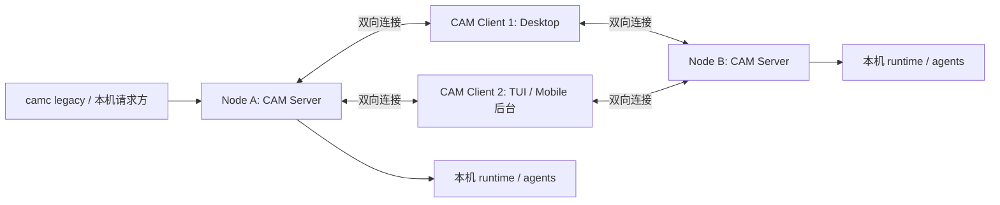
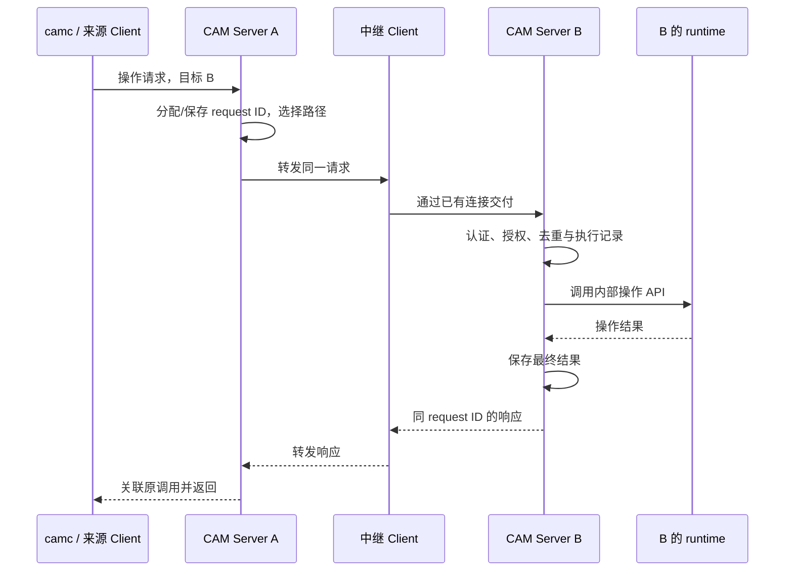

# CAM Client / Server 架构与多路径通信 Spec

日期：2026-10-18

状态：目标设计草案；角色与拓扑按本次讨论对齐，实现尚未完成。

范围：术语、职责、连接、跨机器请求与响应、可靠性、旧组件归并及验收。

## 1. 目标与文档边界

CAM 的产品架构只有 **Client** 与 **Server** 两种角色。每台纳入管理的机器运行一个 CAM Server；多个 Client 可以同时连接多个 Server。Client 的连接与中继能力使两个 Server 之间可以存在多条通信路径。

`camc` 是 legacy CAM Client，也是迁移期保留的 fallback 工作方式。它当前承担的 agent 信息管理、本机执行和维护能力，需要逐步实现在 CAM Server 中。用户工作流随后逐步切到 CAM TUI、Desktop、Mobile；不以一次重写或立即停用 camc 为前提。

长期目标是 Server 统一管理 agent，新的 Client 使用同一组 API。camc 的 standalone 能力在迁移期间继续可用；是否最终退役，需在新流程和恢复路径验证后另行决定。

本 Spec 规定迁移后的契约，不宣称当前代码已经满足。语言、具体 socket 路径、端口和 wire 编码在实施阶段确定；不得因此改变这里的所有权、投递和去重语义。

既有文档的关系：

- [camc spec](camc-spec.md)：legacy camc 当前行为与兼容约束。
- [Bridge Protocol v1](desktop/bridge-protocol-v1.md)、[camb 实现笔记](desktop/camb-bridge.md)：现有桥接协议与实现，迁移期通过适配器兼容。
- [Fleet Bridge 旧方案](desktop/fleet-bridge-plan.md)：现有 bridge 的背景；目标角色和职责以本文为准。
- [Server/TUI 早期计划](superpowers/plans/2026-10-14-cam-server-and-tui.md)：TUI、终端后端和历史交互的背景；涉及 camc 定位和跨机器职责的部分以本文为准。

## 2. 统一术语

| 名称 | 定义 | 实例边界 |
| --- | --- | --- |
| Node / 机器 | 纳入管理的一台机器；不能只用可变 hostname 或 UI 别名作为身份 | 一个稳定 `node_id` |
| CAM Server | 机器上的常驻后端，管理本机 agent、提供 API、维护连接和路由请求 | 每个 Node 一个 active 实例 |
| CAM Client / 终端 | 用户使用的客户端，包括 Desktop、Mobile、TUI 和 legacy camc | 一个 Client 可连多个 Server，一个 Server 可连多个 Client |
| Hub / 中继 | Client 承担的跨 Server 转发能力 | 是 Client 的内部能力，不是第三种产品角色 |
| Tunnel / 通道 | 承载 Client–Server 通信的连接机制，例如 SSH 转发 | 一个 Server 可以同时拥有多条通道 |
| Agent | 由一个 owner Server 管理的工具会话 | 身份为 `(owner_node_id, agent_id)` |
| Tool | Claude、Codex、Cursor、Pi 等实际进程 | 由 Server 的本机 runtime 管理 |

Desktop 可以在应用后台内置中继。Mobile 的中继由其连接后台承担，浏览器不需要直接实现 SSH；多个页面可以共用同一个 Client 后台。路径数量按独立的连接/中继实例计算，不能按 UI 窗口数量计算。

`TunnelHub` 是当前 Python 实现的类名，`camb` 是现有辅助程序，`camc tunnel` 是现有命令组；三者都不定义新的架构角色。

## 3. 拓扑与不变式



1. 同一 Node 不能因增加 Client、工作区或 agent 再启动一个 active CAM Server。第二个实例必须明确拒绝启动，或连接已有实例。
2. `camc → CAM Server` 是 API 依赖方向；CAM Server 不启动 camc CLI，也不通过 SSH 执行远端 camc CLI。
3. Client 连接 Server，并通过已建立的双向连接承接转发。Server 可以在这些连接上发出请求，不要求 Server 能独立连到 Client 的监听地址。
4. 目标架构中，每个 agent 只有一个 owner Server。迁移期尚由 legacy camc 管理的 agent 必须明确标记其管理后端；Server 导入的只读信息不代表已经接管。任何时刻，每个 agent 的权威信息与控制操作都只能有一个管理后端。
5. Client 退出不停止 agent；一条通道断开不表示 agent dead。
6. 多条路径共享同一个业务请求身份，不能因重连、换 Client 或换 transport 重新生成 request ID。

本阶段只要求 `Server A → 一个 Client → Server B`，以及 Client 直接调用目标 Server。不引入多个 Client/Server 连锁转发；中继请求不能再交给另一个中继形成环路。

## 4. 职责

### 4.1 CAM Server

- 唯一写入并维护本机 agent registry、生命周期、退出原因及运行位置。
- 逐步接管 camc 的 agent 信息管理：身份、名称、标签、工作区、工具配置、session/launch 绑定、状态与时间戳、运行位置、历史记录索引和恢复所需配置。
- 直接调用 runtime 服务管理 tool、tmux/PTY、环境、launcher、隔离 tool home、输入和历史；不调用 camc 可执行文件。
- 提供本机 IPC 与远端 Client API；本机操作不依赖任何远端 Client 在线。
- 管理所有 Client 连接、可达目标和连接健康状态；选择转发路径、退避重连、跟踪未完成请求并关联响应。
- 目标端校验权限、核对请求身份与内容、执行去重，并持久化修改操作的执行记录与结果。
- 发布带序号的状态事件。Client 重连通过快照加后续事件恢复，不自行扫描 tmux、进程或 registry。

原 camc 的执行能力迁入 Server 的内部模块或共享 runtime 库。Server 不依赖 argparse、CLI 输出解析或嵌套命令来实现 API。

### 4.2 CAM Client

- 提供 Desktop、Mobile、TUI 或 CLI 交互，连接并展示多个 Server。
- 汇总 Server 快照和事件；显示 owner Node、更新时间及 stale/offline 状态。
- 在获得授权时，把一个 Server 的请求转发给自己直接连接的目标 Server，并把响应返回请求来源。
- 发布自己当前直接连接的 Node 集合，供来源 Server 选择路径；不把从别处听到的路由再次宣告为直连。
- 负责 UI 布局、终端显示、PageUp/PageDown、历史 viewport、鼠标选区和用户本机剪贴板。UI 状态不成为 agent 运行状态的权威。

新流程的 Client 不启动远端 camc CLI，不维护另一份 agent 生命周期，也不因自身断线对未知结果的修改请求重新发起业务操作。legacy camc 的 standalone fallback 按下节的管理后端边界保留。

### 4.3 Legacy camc、新 Client 与 fallback

- camc 可以作为 Server API 的 CLI adapter，也保留 legacy standalone 工作方式。迁移不能以先删掉其可用能力为条件。
- CAM TUI、Desktop、Mobile 使用同一组 Server API，按已验证能力逐步切换。某一个新 Client 的完成不代表所有旧工作流已经迁移。
- 新 UI 不可用但 Server 正常时，已具备对应 API adapter 的 camc 可以作为备用入口；操作仍由同一个 Server 处理。
- 对仍由 legacy camc 管理的 agent，用户可继续使用其原有 standalone 操作；新 Server 暂未实现相应能力，不应使旧流程失效。
- 每个会话必须明确由 legacy runtime 或新 Server runtime 中的一方拥有，禁止同时写同一份 registry、monitor 或 tmux 控制状态。业务操作使用哪个后端必须在执行前确定。
- 不为新 Server 的兼容性要求用户安装或常驻一个独立 camc 接收进程。

### 4.4 Agent 信息管理的渐进迁移

迁移包含信息读取、维护和执行配置，不仅是把通信能力移进 Server。至少覆盖以下信息：

| 信息 | Server 的目标能力 |
| --- | --- |
| 身份与定位 | agent ID、名称、标签、工作区、owner Node，以及当前由 legacy 还是 Server 管理 |
| 工具与启动配置 | tool、tool directory、options、launcher、环境覆盖及隔离 home 策略；支持重启时复用已保存的配置 |
| 会话与运行位置 | tool session、launch 代次、tmux/PTY 关联、submit host、execution host 和 allocation 信息 |
| 运行状态 | alive/dead、idle/running、initializing/started、时间戳及退出或失败原因 |
| 历史与维护 | 历史/日志索引、查询和信息维护 API，以及 heal、归档、清理需要的记录 |

敏感配置保存在受保护的后端存储中；普通列表、状态 API 和默认日志只返回必要的元数据，不回传环境中的 secret。信息迁移要保留恢复操作所需的值，不得为了展示而丢掉它们。

| 阶段 | 信息与控制的权威来源 | Client 的工作方式 |
| --- | --- | --- |
| Legacy 基线 | camc 原有记录与 runtime | 旧 camc 正常使用；新的 Server 可以尚未部署 |
| Server 信息接入 | 对未迁移 agent，camc 仍是权威；Server 只读导入/索引并标注来源与更新时间 | 新 Client 先验证列表、状态、配置与历史查询，旧 camc 继续工作 |
| 按 agent 接管 | 被选中的 agent 及其权威信息和控制切到 Server；其余仍归 legacy | 新 Client 与 camc API adapter 操作 Server-owned agent；legacy 操作其余 agent |
| 新流程为主 | 已迁移能力由 Server 管理 | TUI/Desktop/Mobile 逐步成为常用入口，camc 保留经验证的备用路径 |

Server 可直接读取或通过库适配 legacy 数据格式，不能通过运行 camc CLI 导入信息。只读导入不写回 legacy 记录，不增加第二个 monitor，也不重新启动已有 tool。信息与控制权转交时保留 agent 身份、必要配置及历史关联，并验证当前 launch；同一个 agent 不能在列表中变成两个可独立控制的副本。

### 4.5 Fallback 与回退规则

- Server 尚未接管的 agent，可以使用 legacy camc fallback；新 Client 缺少能力时明确显示支持范围，不伪装成操作成功。
- Server-owned agent 仍通过 Server 管理。Server 暂时不可用时，返回不可达或显示标明时间的只读缓存；不能仅凭断线就让 legacy camc 直接接管。
- 已提交而结果未知的操作，继续以原 request ID 查询或恢复；不能在超时后自动切到 legacy backend 再执行一次。
- 若需从 Server-owned 回退到 legacy，必须先确认原 owner 已释放控制权或被可靠隔离，再转交记录、配置与实际会话；交接后只能有一个活跃管理后端。保留可核对的交接结果。
- 不影响既有 standalone 工作流是迁移验收的一部分。旧能力只有在新路径、备用入口、信息兼容和回退都已验证后，才进入删除候选。

## 5. 身份、连接与可达性

| 字段 | 语义 |
| --- | --- |
| `node_id` | Node 的稳定身份；别名、IP、SSH endpoint 和 hostname 可作为连接信息，不能替代它 |
| `server_epoch` | 当前 Server 启动代次；重启后改变，重启本身不改变 `node_id` |
| `client_id` | 独立 Client 后台的稳定身份；不是浏览器 tab ID |
| `request_id` | 一个业务请求的全局唯一 ID；重试保持不变 |

Client–Server 建连时协商协议版本、角色、身份、认证及能力，随后交换可达信息和快照。协议不兼容或未获授权必须明确失败。

Server 为每个 Client 连接分别保存状态、代次、可达目标和最后更新时间。连接断开或通告过期后，该连接的路径立即失效；其他连接仍可使用。不得用单个 `reverse.pid`、一个全局 Hub 名称或一个连接状态文件代表所有 Client。

Server 单实例锁、socket、连接状态及活跃队列必须放节点本地；共享 NFS Home 不能让不同机器覆盖对方的 PID、epoch、端口或锁。持久身份配置和运行记录按 Node 隔离。

注册认证凭据与 endpoint 认证凭据必须语义分开。若注册请求携带 endpoint token，它必须与目标 endpoint 真正使用的 token 一致，不能把注册 Bearer token 默认当作 endpoint token。

## 6. 操作 API 与消息信封

以下是目标协议的逻辑结构，字段不依赖 SSH、WebSocket 或本机 socket 等具体 transport。现有 argv/JSON-line 协议可在边界适配，不作为 Server 内部执行接口。

```json
{
  "version": 1,
  "type": "request",
  "request_id": "7bb96032fd3e4ea99938a6d1e6067d74",
  "source": {"kind": "node", "id": "node-a"},
  "target": {"node_id": "node-b", "agent_id": "1234abcd"},
  "operation": "agent.capture",
  "params": {"lines": 50},
  "deadline_at": "2026-10-18T21:00:30Z"
}
```

直接由 Client 发出的请求使用 `source.kind = "client"` 和其 `client_id`。认证后的连接必须约束来源身份；接收方不能无条件相信 payload 自报的来源。

```json
{
  "version": 1,
  "type": "response",
  "request_id": "7bb96032fd3e4ea99938a6d1e6067d74",
  "owner_node_id": "node-b",
  "server_epoch": "boot-b-2",
  "status": "ok",
  "result": {"text": "agent output", "truncated": false}
}
```

- 已知的最终执行结果使用 `status = ok` 或 `error`。错误包含结构化 `error.code` 与 `error.message`；不能靠解析一段 CLI stderr 判断传输是否成功。
- 请求等待路径、排队或执行期间，可以返回 `pending` 确认；这不是最终错误，也不表示 agent 已经 started。
- 执行发生与否不能确认时返回 `unknown`，并允许通过原 request ID 查询；不能把它伪装成普通失败后自动重做。
- 路径选择、尝试次数和使用的 `client_id` 属于传输元数据，不能改变业务请求的来源、目标、操作、参数和 ID。
- 第一版需要版本化的 API 至少覆盖：`agent.list/get/start/stop/reboot/kill/remove`、`agent.capture/send/key`、`message.send`、`request.get`。能力协商决定可用范围；未实现的操作返回 `UNSUPPORTED_OPERATION`，不能退回执行任意 CLI。
- 终端 attach/input/resize、历史读取和状态事件通过独立逻辑通道承载，避免大量终端输出阻塞管理请求。帧大小、历史分页、队列及输出缓存必须有上限；截断需要明确标记。

## 7. 一次跨 Node 操作



若来源就是一个直接连接 B 的 Client，可省略 A 和中继跳转。若目标就是 A，本机 runtime 直接处理，不经过其他 Client。

目标解析完成后，重试不能把 B 上的 agent 名称换到另一台机器。最终目标必须固定为明确的 owner Node 与 agent 身份；名称或短 ID 有歧义时返回候选，不猜测、不广播执行。

目标结果已保存但原路径断开时，来源可以通过另一条路径以原 request ID 查询或重投同一个请求。B 返回已保存结果；不要求响应只能走已经失效的原路径。

## 8. 多路径路由

来源 Server 保存形如 `目标 node_id → 可用 Client 连接集合` 的路由信息。本机优先；跨 Node 请求只选择宣告可直接到达目标且获得授权的 Client。

1. 正常情况选择一条健康路径；第一版不并行向多条路径发送修改操作。
2. 传输失败后可以选择另一条健康路径，保留原请求身份；收到目标的最终业务错误后不能换路径再次执行业务操作。
3. 路由通告是带有效期的可达提示；目标 Server 仍需独立校验权限和请求。
4. Client 转发时核对目标确为自己的直连 Node；不再做递归路由，不把请求送回来源。
5. 没有路径时，来源 Server 保留可重试请求至其 deadline，并报告 `pending`。deadline 到达时，尚未开始执行的请求终结为 `ROUTE_UNAVAILABLE` 或 `DEADLINE_EXCEEDED`。

第一版选择简单、稳定、可解释的顺序；路径质量评分等优化不作为前置条件。路径变化不转移 agent ownership，也不改变 launcher 的执行位置。

## 9. 去重、结果与故障恢复

**目标 CAM Server 统一去重。** Client 或来源 Server 的缓存只能加速，不能代替目标端去重；不同 Client 可能先后送达同一个请求。

- 去重键为认证后的来源身份加 `request_id`；记录目标、operation 和 params 的摘要。同一键带不同内容必须返回 `REQUEST_CONFLICT`。
- 第一次接受修改操作时，先持久化执行记录，再产生副作用。同一请求执行中再次到达时复用执行记录；执行完成后再次到达时返回缓存的最终结果。
- 临时断线、路径不可用和 release/requeue 不是最终业务结果，不能进入终态结果缓存，更不能提前覆盖最终响应。
- 请求不能在简单 dequeue/打印后就失去恢复依据。来源保存未决请求，目标保存执行记录和结果；中继退出不应使请求与结果的唯一副本一起消失。
- 最终结果在来源确认接收前保持可恢复。去重记录覆盖协议允许的重试期限；清理结果后，过期请求仍必须被拒绝，不能当作新操作执行。
- Server 重启后核对未完成的执行记录和实际 runtime。能确认结果则恢复；无法区分“尚未执行”和“已执行但未记录结果”时，标记 `unknown`，禁止盲目重放。
- 通信 deadline 限制尚未执行请求的等待时间。操作已被接受并开始执行后，调用方超时或断线不自动杀掉 agent，也不证明操作失败；调用方按原 ID 查询结果。

本 Spec 不承诺所有故障下的 exactly-once。保证是：正常重试和多路径重复交付不产生重复副作用；跨崩溃的不确定操作明确返回 `unknown`，不以自动重复执行换取假成功。

## 10. Agent 状态与终端边界

agent 生命周期沿用已简化的模型：

| 生命周期 | state | phase |
| --- | --- | --- |
| `alive` | `running` | `initializing` 或 `started` |
| `alive` | `idle` | `started` |
| `dead` | `stopped` / `failed` / `killed` | 无 |

请求的 pending/ok/error/unknown 与 agent 状态是两回事。连接 offline、列表 stale 或请求超时，不能直接把 agent 写成 dead。

`agent.start` / reboot 可以先返回新 agent/launch 的身份和 initializing 阶段，让 UI 立即提供终端。owner Server 必须继续护航到 started，或给出明确的 failed 原因；不能把“会话已创建”显示为“工具已就绪”。

owner Node、submit host 和 tool 实际 execution host 分别记录。LSF/launcher 把工具放到另一台机器执行，不自动改变控制该会话的 owner Server。现有 tool resolve、环境、autorun、launcher 和隔离 home 策略在迁移中保持独立，不由中继改写。

UI 关闭或浏览历史不影响 tool；选区与 copy/paste 属于用户端。管理 API、终端会话和完整工具对话记录需要区分，不能把 capture 输出当成完整会话历史。

## 11. 访问与可观测性

- 本机 IPC 与远端通道都需绑定明确身份和授权范围。Client 仅能中继其获得授权的 Node/操作；目标 Server 始终重新校验，不能只相信中继的声明。
- Server 接受结构化操作和参数；中继不把用户内容拼成 shell 命令。自定义 tool launcher 仍由 runtime 按既有显式配置处理。
- 日志简短记录 request ID、来源/目标 Node、所用 Client、路径切换原因、结果和耗时；token、完整环境值、凭据和敏感请求正文不进入默认日志。
- 每个通道分别展示 connected/disconnected、更新时间及错误原因。Server API 可分别查询 agent、连接、路由和未决请求，避免把它们合成一个模糊的状态。

## 12. 旧组件归并与删除边界

| 当前组件 | 目标归属 | 删除条件 |
| --- | --- | --- |
| camc 的参数解析、文本输出和脚本入口 | legacy Client adapter 与 fallback 入口 | 新 Client/API 已覆盖所需工作流，备用与恢复路径通过验收，且用户决定退役 camc |
| camc 的 agent 信息管理、registry、runtime、monitor、launcher 等后端能力 | 逐步实现在 CAM Server 内部服务或共享库中 | 按能力和 agent 迁移；只删除已无 legacy fallback 依赖的重复实现，不因 Server 新增能力就立即删旧路径 |
| `camc tunnel` 的 endpoint、keeper、通道状态和请求队列 | CAM Server 连接与请求管理 | 等价路径通过验收后删除独立命令组及重复守护进程 |
| `camb` 的请求封装、serve、reverse maintainer | CAM Server 通信实现；必要的 legacy 协议 adapter | 旧部署和调用方迁移后删除独立程序及自动部署逻辑 |
| Python `TunnelHub` | 路由/结果跟踪归 Server；跨 Server 转发归 Client 连接层 | 对应职责迁移后删除独立类和 Hub 模式，不保留第二套 router |
| Desktop embedded hub 的跨机器连接与中继 | CAM Client 的后台连接层 | 保留必要能力，收口到统一 Server 协议；原 camc SSH 执行 adapter 随迁移删除 |

最终不需要独立的 Hub 产品、每台机器上的 camb 服务，或 Server 调用 CLI 的执行链。SSH tunnel、认证、队列、重连和去重作为内部能力继续存在。

迁移期间，协议 adapter 必须明确版本、能力及会话 owner；不能先删除旧路径再让用户承担不可用窗口。新旧 runtime 的权威写入状态和临时状态隔离；Server 可以按 §4.4 只读索引 legacy 信息。切换 ownership 必须验证已有会话、保存配置、回收责任和回退办法。

## 13. 验收

使用至少两个独立 Node（A、B）和两个独立中继 Client（C1、C2），两者都连接 A、B。只开两个 UI 页面、共用同一个后台，不能算双路径测试。

| 场景 | 必须观察到的结果 |
| --- | --- |
| 同 Node 启动第二个 Server | 明确拒绝或连接已有实例；只有一个 owner |
| 所有远端 Client 离线 | A 的本机管理操作正常，agent 不受影响 |
| A → C1 → B，C1 → B 直接调用 | 正确目标执行，原 request ID 的响应返回来源 |
| C1 断开，C2 保持在线 | 同 ID 改走 C2；连接错误不污染 agent 状态 |
| 两条路径送达同一修改请求 | 目标只产生一次副作用，返回同一个最终结果 |
| 目标已执行但回包丢失 | 经 C2 重投/查询得到原结果，不再执行 |
| 第一次暂不可达，随后恢复 | 请求实际重试并成功，不命中旧的临时失败终态缓存 |
| 注册成功后实际调用 endpoint | 认证通过且操作成功；不能只验 SSH/端口/注册成功 |
| 中继重启、来源重启、目标重启 | 分别验证队列/结果恢复；不确定执行返回 unknown |
| 同 ID 不同参数、过期请求、歧义目标、递归中继 | 明确拒绝，不执行副作用 |
| 两个 Client 同时观察一个 agent | owner 与生命周期一致；各自历史 viewport 独立 |
| start/reboot 后出现确认或启动错误 | 护航到 started 或明确 failed，不停留在假就绪状态 |
| Server 尚未部署或能力未覆盖 | legacy camc 对原有 agent 的工作方式保持可用 |
| Server 只读导入 legacy agent 信息 | ID、配置、状态和历史关联可核对，标明来源/更新时间；不改旧记录，不新增控制进程 |
| 单个 agent 转交给 Server | 身份和必要配置保留；Client 列表中只有一个可控制对象；其他 legacy agent 不受影响 |
| 新 Client 故障，Server 正常 | 对应的 camc API adapter 可完成同一操作，仍由原 Server 执行 |
| Server 断线或修改请求结果未知 | 不自动用 legacy backend 重放；恢复后可按原 request ID 查询 |
| 显式回退某个 agent 到 legacy | 原控制权已释放或被可靠隔离，记录与会话可核对，只有一个管理后端 |

自动测试需分别覆盖协议语义和底层 transport。真实验收至少对 Claude、Codex 各跑一次受控启动、状态读取、消息/输入、stop/reboot 及回收；后续 Client 逐个验证。临时 agent、测试 Server/连接和测试创建的 allocation 全部回收；复用的用户会话或 allocation 不属于测试回收范围。

当前的单元测试通过、端口可连、HTTP 注册成功，都不能代替上述端到端验收。未验证的平台和路径必须明确记录。

## 14. 实施顺序

1. 冻结本文术语、管理后端边界、fallback 与最小 API；保留 camc 的可用基线，用模拟 runtime 验证请求生命周期、目标去重及双 Client 路由。
2. 建立唯一 Server，逐步实现 agent 信息管理；先做 legacy 信息的只读导入与核对，接通新 Client 的查询流程，不改变旧 agent 的控制权。
3. 接入 Client 连接管理和身份握手；先打通 A → C1 → B，再接 C2 并验证路径切换。
4. 逐步接入本机 runtime、状态与终端能力，确保 Server 不启动 camc CLI；按已验证能力和 agent 转交管理权，保留其他 legacy agent 的原工作方式。
5. 为迁移的能力提供 camc API adapter，并让 TUI/Desktop/Mobile 逐步切到同一组 API；验证备用入口、会话交接、回退和实际工具流程。
6. 完成真实多路径、重启、Claude/Codex 及资源回收验收后，仅删除已迁移且无 fallback 依赖的 camb、camc tunnel、TunnelHub 重复实现。camc 的 standalone fallback 在仍有依赖时保留，最终退役另行决定。

实施前需要落定的协议细节是 wire 编码、地址发现/部署、认证凭据分发、API 能力版本、持久化布局与容量/保留期限。首版范围是一跳 Client 中继；跨多个 Client/中间 Server 的传递路由留作后续范围决定。这些选择不得放宽单实例、目标端去重和明确返回不确定结果的要求。
