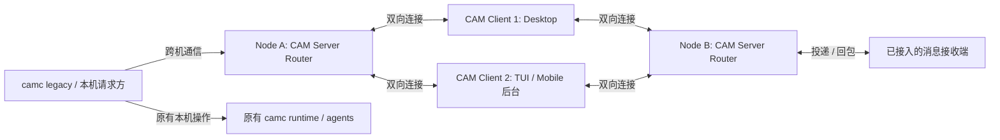
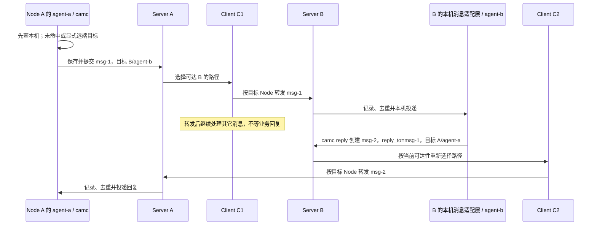

# CAM Client / Server 架构与多路径通信 Spec

日期：2026-10-18；更新：2026-10-19（统一 message 路由）

状态：目标设计；Rust Router、Client forwarding 参考组件和 camc SDK 接入已实现，单机多进程验收通过；各平台 Client 集成与物理跨主机部署继续验收，agent 管理随后迁移。

范围：术语、职责、连接、跨机器请求与响应、可靠性、旧组件归并及验收。

## 1. 目标与文档边界

CAM 的产品架构只有 **Client** 与 **Server** 两种角色。每台纳入管理的机器运行一个 CAM Server；多个 Client 可以同时连接多个 Server。Client 的连接与中继能力使两个 Server 之间可以存在多条通信路径。

`camc` 是 legacy CAM Client，也是迁移期保留的 fallback 工作方式。它当前承担的 agent 信息管理、本机执行和维护能力，需要逐步实现在 CAM Server 中。用户工作流随后逐步切到 CAM TUI、Desktop、Mobile；不以一次重写或立即停用 camc 为前提。

**当前阶段是 Router 先行。** 新增 CAM Server 先负责连接、路由、请求投递与响应关联。camc 现有的 agent 信息、状态、管理、runtime、monitor 和 launcher 保持原有工作方式；Desktop/Mobile 当前经 SSH 调用 camc 的路径也继续可用。Router 上线不以迁移这些能力为前置条件。

长期目标是把 camc 的 agent 信息与管理能力逐项实现到 CAM Server，CAM TUI/Desktop/Mobile 直接使用 Server API，最终退役 camc。camc 的 standalone 能力作为迁移期 fallback 保留；退役要等新流程、脚本兼容及恢复路径达到验收条件。

本 Spec 规定迁移后的契约，不宣称当前代码已经满足。语言、具体 socket 路径、端口和 wire 编码在实施阶段确定；不得因此改变这里的所有权、投递和去重语义。

既有文档的关系：

- [CAM Client Forwarding Spec](cam-client-forwarding-spec.md)：Client 专用转发通道、可达通告、统一消息转发、恢复及逐项验收要求；属于本文 Router 阶段的 Client 侧契约。
- [camc Server 接入](camc-server-integration.md)：已实现的本机 IPC、原生 SDK 后端与验收边界。
- [CAM Client 本地守护进程 Spec](cam-client-daemon-spec.md)：TUI 常驻后台、状态缓存、定时任务、engineering loop、forwarding 与健康检查的职责边界；v0.1 范围见 [版本说明](cam-tui-v0.1.md)。
- [Rust Router 使用与构建](../components/cam-router/README.md)：独立服务、Client 参考组件、通道配置、持久队列和通用 Linux 静态构建；Python 包旧入口暂不替换。
- [camc spec](camc-spec.md)：legacy camc 当前行为与兼容约束。
- [Bridge Protocol v1](desktop/bridge-protocol-v1.md)、[camb 实现笔记](desktop/camb-bridge.md)：现有桥接协议与实现，迁移期通过适配器兼容。
- [Fleet Bridge 旧方案](desktop/fleet-bridge-plan.md)：现有 bridge 的背景；目标角色和职责以本文为准。
- [Server/TUI 早期计划](superpowers/plans/2026-10-14-cam-server-and-tui.md)：TUI、终端后端和历史交互的背景；涉及 camc 定位和跨机器职责的部分以本文为准。

## 2. 统一术语

| 名称 | 定义 | 实例边界 |
| --- | --- | --- |
| Node / 机器 | 纳入管理的一台机器；不能只用可变 hostname 或 UI 别名作为身份 | 一个稳定 `node_id` |
| CAM Server | 机器上的常驻服务；当前先做 Router，随后逐步承接 agent 信息与管理 API | 每个 Node 一个 active 实例 |
| CAM Client / 终端 | 用户使用的客户端，包括 Desktop、Mobile、TUI 和 legacy camc | 一个 Client 可连多个 Server，一个 Server 可连多个 Client |
| Hub / 中继 | Client 承担的跨 Server 转发能力 | 是 Client 的内部能力，不是第三种产品角色 |
| Tunnel / 通道 | 承载 Client–Server 通信的连接机制，例如 SSH 转发 | 一个 Server 可以同时拥有多条通道 |
| Agent | 当前由 legacy camc 管理、后续按批次迁到 Server 的工具会话 | 身份为 `(owner_node_id, agent_id)`，另标注管理后端 |
| Tool | Claude、Codex、Cursor、Pi 等实际进程 | 当前 runtime 不变，后续按能力迁入 Server |

Desktop 可以在应用后台内置中继。Mobile 的中继由其连接后台承担，浏览器不需要直接实现 SSH；多个页面可以共用同一个 Client 后台。路径数量按独立的连接/中继实例计算，不能按 UI 窗口数量计算。

`TunnelHub` 是当前 Python 实现的类名，`camb` 是现有辅助程序，`camc tunnel` 是现有命令组；三者都不定义新的架构角色。

## 3. 拓扑与不变式



1. 同一 Node 不能因增加 Client、工作区或 agent 再启动一个 active CAM Server。第二个实例必须明确拒绝启动，或连接已有实例。
2. 新流程中 `camc / 新 Client → CAM Server` 是 API 依赖方向；新增 CAM Server 不启动 camc CLI，也不通过 SSH 执行远端 camc CLI。现有 Client 的 legacy SSH/camc 调用不在 Router 首版被强制替换。
3. Client 连接 Server，并通过已建立的双向连接承接转发。Server 可以在这些连接上发出请求，不要求 Server 能独立连到 Client 的监听地址。
4. 目标架构中，每个 agent 只有一个 owner Server。迁移期尚由 legacy camc 管理的 agent 必须明确标记其管理后端；Server 导入的只读信息不代表已经接管。任何时刻，每个 agent 的权威信息与控制操作都只能有一个管理后端。
5. Client 退出不停止 agent；一条通道断开不表示 agent dead。
6. 同一消息重试、重连或换 Client 保持原 `message_id`；业务回复是新 message，使用新 ID 和 `reply_to`，独立选路。Client 不等待业务回复、不维护业务回程表。

本阶段只要求 `Server A → 一个 Client → Server B`，以及 Client 直接调用目标 Server。不引入多个 Client/Server 连锁转发；中继请求不能再交给另一个中继形成环路。

## 4. 职责

### 4.1 CAM Server：当前 Router 与后续后端

Router 首版负责：

- 提供本机通信入口与 Client 连接接口，登记身份、连接能力及可达目标。
- 管理所有 Client 连接和连接健康状态，选择路径、处理断线与重连。
- 接收本机调用方的跨 Node 消息，转发到合适的 Client，再交给目标 Node；request 与 reply 使用同一消息投递入口。
- 目标端校验信封与权限，按认证来源和 `message_id` 去重，记录投递；业务回复由本机接收端生成新 message，Router 状态与 agent 状态分开存储。
- 向已经接入的本机接收端或兼容 mailbox 交付消息。接收端负责业务处理，Server 不为此启动 camc CLI、tool 或新的 agent monitor。
- 提供连接、路由、请求查询及简短日志。尚无可处理业务的接收端时，明确返回不支持或不可达，不能把“已路由”当作“操作已完成”。

首版不读写 agent registry，不接管生命周期、tmux、monitor、环境、launcher 或 tool home，也不要求先实现 agent 列表/状态 API。现有本机操作继续走原有 camc；Router 故障不影响它们。

后续按能力迁入：

- agent 信息、配置、session/launch 绑定、状态、历史及恢复数据的管理。
- agent 生命周期和 runtime 服务，包括 tool、tmux/PTY、环境、launcher、隔离 home、输入和历史读取。
- 带序号的 agent 事件和快照 API；已迁移 agent 的权威状态由 Server 维护。

这些是后续阶段的验收目标。迁入 Server 的能力使用内部模块或共享库，不依赖 argparse、CLI 输出解析或嵌套 camc 命令。

### 4.2 CAM Client

Client forwarding 的必做清单、通道和验收以 [CAM Client Forwarding Spec](cam-client-forwarding-spec.md) 为准。每个 Server 使用专用双向 forwarding 通道，与终端 attach/输出分开；Client 统一按目标 Node 转发 message，不保留业务回程映射。

- 提供 Desktop、Mobile、TUI 或 CLI 交互，连接并展示多个 Server。
- 对已迁移能力，汇总 Server 快照和事件，显示 owner Node、更新时间及 stale/offline 状态；Router 首版不要求替换现有 camc 信息读取。
- 在获得授权时，把一个 Server 发出的 message 转给自己直接连接的目标 Server；业务回复同样按目标地址转发，可以经过另一个 Client。
- 发布自己当前直接连接的 Node 集合，供来源 Server 选择路径；不把从别处听到的路由再次宣告为直连。
- 负责 UI 布局、终端显示、PageUp/PageDown、历史 viewport、鼠标选区和用户本机剪贴板。UI 状态不成为 agent 运行状态的权威。

新 Server API 已覆盖的能力，由 Client 直接调用；其余保留现有 legacy 操作路径。纯中继不执行 camc CLI、不维护 agent 生命周期，也不因自身断线重新发起结果未知的修改操作。legacy fallback 按下节的管理后端边界保留。

#### 4.2.1 TUI 的本地 Client daemon

CAM TUI 使用独立的本地常驻后台，暂称 `cam-clientd`，每台客户端机器、每个用户一份；多个 TUI 窗口共用。它负责连接多个 Server、持续汇总 agent list/status、运行用户注册的定时任务和 engineering loop，并承载 Client forwarding 与分层健康检查（含 tunnel alive 和按需 forwarding 验证）。TUI 退出不结束这些后台工作。

daemon 属于 Client 角色；不是每个 Node 上的第二个 CAM Server，不持有 agent runtime 的权威状态、不新增第二套 monitor。Server/实际管理后端提供状态与操作，daemon 订阅、缓存、调度，TUI 显示和交互。状态同步 loop 与 idle-gated engineering prompt loop 是两项不同能力。

纯 forwarding 与 daemon 主动注册的业务调度分离：前者不保存业务回程表，后者可持久保存自己的任务计划与触发记录。两端 Server 仍负责消息去重、执行结果关联及 loop 最终交付时的状态/调度权检查。单 daemon 多窗口、跨 daemon 多路径、调度权交接与未知结果恢复详见 [本地守护进程 Spec](cam-client-daemon-spec.md)。基础 daemon 已有 [v0.1 实现](cam-tui-v0.1.md)，完整设计仍按能力迁移验收。

### 4.3 Legacy camc、新 Client 与 fallback

- Router 首版保留 camc 的 legacy standalone 工作方式；消息发送先查本机 agent，本机未命中才交给本机 Server。显式远端 Node 直接走对应目标；本机投递失败不冒充目标不存在。后续已迁移能力可提供 camc API adapter，这不是 Router 上线的前置条件。
- CAM TUI、Desktop、Mobile 使用同一组 Server API，按已验证能力逐步切换。某一个新 Client 的完成不代表所有旧工作流已经迁移。
- 新 UI 不可用但 Server 正常时，已具备对应 API adapter 的 camc 可以作为备用入口；操作仍由同一个 Server 处理。
- 对仍由 legacy camc 管理的 agent，用户可继续使用其原有 standalone 操作；新 Server 暂未实现相应能力，不应使旧流程失效。
- 每个会话必须明确由 legacy runtime 或新 Server runtime 中的一方拥有，禁止同时写同一份 registry、monitor 或 tmux 控制状态。业务操作使用哪个后端必须在执行前确定。
- 不为新 Server 的兼容性要求用户安装或常驻一个独立 camc 接收进程。

### 4.4 Agent 信息管理的渐进迁移

本节属于 Router 之后的阶段。迁移包含信息读取、维护和执行配置，至少覆盖以下信息：

| 信息 | Server 的目标能力 |
| --- | --- |
| 身份与定位 | agent ID、名称、标签、工作区、owner Node，以及当前由 legacy 还是 Server 管理 |
| 工具与启动配置 | tool、tool directory、options、launcher、环境覆盖及隔离 home 策略；支持重启时复用已保存的配置 |
| 会话与运行位置 | tool session、launch 代次、tmux/PTY 关联、submit host、execution host 和 allocation 信息 |
| 运行状态 | alive/dead、idle/running、initializing/started、时间戳及退出或失败原因 |
| 历史与维护 | 历史/日志索引、查询和信息维护 API，以及 heal、归档、清理需要的记录 |

敏感配置保存在受保护的后端存储中；普通列表、状态 API 和默认日志只返回必要的元数据，不回传环境中的 secret。信息迁移要保留恢复操作所需的值，不得为了展示而丢掉它们。

| 阶段 | 信息与控制的权威来源 | Client 的工作方式 |
| --- | --- | --- |
| Legacy 基线 | camc 原有记录与 runtime | 旧 camc 正常使用；新的 Server 可以尚未部署 |
| Router 先行（当前阶段） | agent 信息与控制仍全部由原 camc 管理；Server 只维护通信记录 | 接入连接/路由/请求响应；其它流程保持不变 |
| Server 信息接入 | 对未迁移 agent，camc 仍是权威；Server 只读导入/索引并标注来源与更新时间 | 新 Client 先验证列表、状态、配置与历史查询，旧 camc 继续工作 |
| 按 agent 接管 | 被选中的 agent 及其权威信息和控制切到 Server；其余仍归 legacy | 新 Client 与 camc API adapter 操作 Server-owned agent；legacy 操作其余 agent |
| 新流程为主 | 已迁移能力由 Server 管理 | TUI/Desktop/Mobile 直接使用 Server API，camc 保留经验证的备用路径 |
| 退役 camc | 所需信息与管理能力已迁入 Server，兼容与恢复验收完成 | TUI/Desktop/Mobile 成为主流入口，替代旧 camc 工作流 |

Server 可直接读取或通过库适配 legacy 数据格式，不能通过运行 camc CLI 导入信息。只读导入不写回 legacy 记录，不增加第二个 monitor，也不重新启动已有 tool。信息与控制权转交时保留 agent 身份、必要配置及历史关联，并验证当前 launch；同一个 agent 不能在列表中变成两个可独立控制的副本。

### 4.5 Fallback 与回退规则

- Server 尚未接管的 agent，可以使用 legacy camc fallback；新 Client 缺少能力时明确显示支持范围，不伪装成操作成功。
- Server-owned agent 仍通过 Server 管理。Server 暂时不可用时，返回不可达或显示标明时间的只读缓存；不能仅凭断线就让 legacy camc 直接接管。
- 已提交而结果未知的操作，继续以原操作消息 ID 查询或恢复；不能在超时后自动切到 legacy backend 再执行一次。
- 若需从 Server-owned 回退到 legacy，必须先确认原 owner 已释放控制权或被可靠隔离，再转交记录、配置与实际会话；交接后只能有一个活跃管理后端。保留可核对的交接结果。
- 不影响既有 standalone 工作流是迁移验收的一部分。旧能力只有在新路径、备用入口、信息兼容和回退都已验证后，才进入删除候选。

## 5. 身份、连接与可达性

| 字段 | 语义 |
| --- | --- |
| `node_id` | Node 的稳定身份；别名、IP、SSH endpoint 和 hostname 可作为连接信息，不能替代它 |
| `server_epoch` | 当前 Server 启动代次；重启后改变，重启本身不改变 `node_id` |
| `client_id` | 独立 Client 后台的稳定身份；不是浏览器 tab ID |
| `message_id` | 一次消息投递的唯一 ID；该消息重试保持不变，reply 使用新 ID |
| `reply_to` | 可选，关联被回复的 message；不决定路由、不要求 Client 保存原请求 |
| `request_id` | 旧协议的调用关联字段；在边界适配为对应 message ID，不要求 Client 维护另一套业务回程 |

Client–Server 建连时协商协议版本、角色、身份、认证及能力，随后交换可达信息和快照。协议不兼容或未获授权必须明确失败。

Server 为每个 Client 连接分别保存状态、代次、可达目标和最后更新时间。连接断开或通告过期后，该连接的路径立即失效；其他连接仍可使用。不得用单个 `reverse.pid`、一个全局 Hub 名称或一个连接状态文件代表所有 Client。

Server 单实例锁、socket、连接状态及活跃队列必须放节点本地；共享 NFS Home 不能让不同机器覆盖对方的 PID、epoch、端口或锁。持久身份配置和运行记录按 Node 隔离。

注册认证凭据与 endpoint 认证凭据必须语义分开。若注册请求携带 endpoint token，它必须与目标 endpoint 真正使用的 token 一致，不能把注册 Bearer token 默认当作 endpoint token。

## 6. 统一消息信封

**跨 agent 的 request 与 response 都是普通 message，走同一发送、路由和投递入口。** 每条消息有独立的来源与目标，Client 只解析选路和权限所需的外层字段，payload 内容保持不变。

以下是逻辑结构；最终 wire 编码在实施阶段确定。请求示例：

```json
{
  "version": 1,
  "type": "message",
  "message_id": "msg-1",
  "source": {"node_id": "node-a", "agent_id": "agent-a"},
  "target": {"node_id": "node-b", "agent_id": "agent-b"},
  "operation": "message.send",
  "payload": {"text": "请检查这个问题"},
  "expires_at": "2026-10-19T21:00:30Z"
}
```

回复仍是相同格式的新 message，收发地址对调：

```json
{
  "version": 1,
  "type": "message",
  "message_id": "msg-2",
  "reply_to": "msg-1",
  "source": {"node_id": "node-b", "agent_id": "agent-b"},
  "target": {"node_id": "node-a", "agent_id": "agent-a"},
  "operation": "message.send",
  "payload": {"text": "检查结果如下"},
  "expires_at": "2026-10-19T22:00:30Z"
}
```

- `message_id` 标识一条独立消息。同一消息重试不能改 ID、目标或正文；`reply_to` 标识业务关联，不是回程地址。
- 来源身份必须由认证关系约束，目标 Server 独立检查来源及中继授权。Client 不能无条件相信 payload 自报身份。
- request 和 reply 均按各自的目标 Node 选择当前可用路径，允许不同 Client；每条消息有自己的投递期限。
- 投递 `pending/delivered/error/unknown` 是传输和接收端状态，不表示 agent 已回答。需要回执时，状态接收端使用普通 message；回执不能触发回执循环或伪装为业务回复。
- 没有业务回复时，由 Server/camc 的消息记录表达等待或超时；Client 不占用连接，不通过终端画面提取回复。
- Router 首版提供消息提交、投递状态、连接与路由查询及接收端接入。通用验收可用 `target.receiver_id=test.echo` 的已注册处理端替代 agent；处理端的回复同样是新 message。
- 真实 `message.send` 需接入 camc 本机消息适配层；尚无接收端时明确返回不支持或不可达。Router 不把 message 转成 camc CLI 命令。
- agent 操作可复用同一 message 通道，operation/payload 由目标接收端处理；调用结果与 agent 对话回复分别记录，均作为新 message 返回。终端 attach 的实时流使用独立通道；首版 Router 不以全部操作已迁入为前置条件。

### 6.1 远端操作范围

本节仅定义新通信协议可以转发的操作白名单，不重写命令行为、不迁移 agent 管理权，也不删改现有本机命令。首版必选为 **msg、send、capture、run、stop、rm、kill、reboot、key、status** 十项；以下“支持”指目标设计范围，不代表当前实现已全部接通。

**第一步只开放面向具体 agent 的业务操作。** 每条业务操作必须携带明确的 `target.node_id` 与 `target.agent_id`，不接受空目标、通配符、批量操作或只有 Node 的业务请求。run 使用预先分配的新 agent ID 创建该目标，其余操作针对已有 agent；不增加列表、聚合或 Node 级业务接口。

目标 Server/本机接收端负责操作白名单和能力检查；Client 只做通用信封转发和通道授权。未列入范围、目标未注册或未获授权的操作明确拒绝，不能通过 Server 或 Client exec camc CLI 补齐。

**首版必选：**

| camc 操作 | message 的 operation / 目标 | 远端通信约定 |
| --- | --- | --- |
| msg send / reply | `message.send`，目标 Node + agent | 投递消息；reply 是新消息，reply_to 指向被回复的消息，Client 不等待业务回复 |
| send | `agent.send`，目标 Node + agent | 向工具终端发送文本，保留 Enter/no-enter 语义，返回输入投递结果 |
| capture | `agent.capture`，目标 Node + agent | 读取对应输出；结果有大小上限，截断/分页情况明确返回 |
| run | `agent.run`，目标 Node + 预分配的新 agent ID | 创建该指定 agent，返回相同 agent ID、新 launch ID 及现有启动过程的关联结果 |
| stop | `agent.stop`，目标 Node + agent | 停止 pane 0 工具并保留 tmux，记录 dead/stopped，返回停止结果 |
| rm | `agent.remove`，目标 Node + agent | 按现有删除/回收语义处理，返回结果，不改变操作范围 |
| kill | `agent.kill`，目标 Node + agent | 销毁 tmux 会话、保留 agent 记录，记录 dead/killed，返回结果 |
| reboot | `agent.reboot`，目标 Node + agent | 保持 agent ID，按保存配置重建 tmux 和工具会话，返回新的 launch ID 与启动结果 |
| key | `agent.key`，目标 Node + agent | 发送 Enter、Escape、方向键等特殊按键，保留现有按键语义并返回投递结果 |
| status | `agent.status`，目标 Node + agent | 查询该 agent 的详细状态及启动阶段，不返回整机或全 fleet 列表 |

**本轮不支持通过新通信协议转发：**

| 范围 | 处理方式 |
| --- | --- |
| list，包括指定远端 Node 查询及跨节点聚合 | 不纳入本轮通信白名单；现有本机 list 保持不变，后续 agent 信息 API 迁移另行定义 |
| migrate、exit、update/add、heal/prune | 暂不列入远端白名单，保留既有本机方式；不能因为有通道就自动开放 |
| logs/history/archive、cron、API/config、env/init、upgrade/skills、tunnel 管理 | 本轮通信范围之外，后续按需要单独决定 |
| attach 的持续终端会话、实时 input/resize | 走独立终端流式通道，不纳入本轮普通消息操作 |
| 任意 shell/命令字符串 | 不作为兜底 operation；只接受已登记的结构化操作 |

消息发送、回复、回执、路由通告和结构化 `operation.result` 是协议自身需要的消息，不因业务操作白名单缩小而禁止。路由通告、内部投递状态和 echo 测试接收端不构成额外的 Node 级业务操作。`msg read/wait/show/list` 对已保存对话的读取和等待由来源 camc/Server 处理，本轮不额外开放读取目标机器任意消息账本的远端操作。

- **定向 agent 操作**：本机查找优先；未命中才交本机 Server。显式远端 Node 优先于同名本机 agent；目标不存在、已命中后执行失败或名称有歧义，均不能换到另一个同名对象执行。
- **send**：与带线程/回复语义的 msg 分开；`--file/--stdin` 内容在发送端读成文本后放入 payload，目标不尝试读取来源机器的文件路径。保留现有输入/Enter 选项，不把输入成功当作 agent 已回答。
- **run**：发送端一次性分配目标 agent ID，连同目标 Node 和启动参数提交；该消息重试保持 agent ID 和 message ID。未指定 Node 时保持本机默认，显式远端则发往该 Node；不能因新 ID 尚不存在而扩大查找或随机选机器。若该 ID 已属于另一操作则返回冲突，不覆盖已有 agent。管理/提交 Node 与 tool-launcher 的 LSF execution host 分开，原 launcher/autorun 策略不变。
- **reboot**：沿用当前语义，用相同 agent ID 重建 tmux 和工具会话，不自动 resume 旧 tool session；保留已保存的 tool、options、tool-env 和 tool-launcher 策略。重复投递同一 reboot 消息返回同一 launch 的记录，不重复重建。
- **key**：按既有键名和发送行为处理，消息重试不得重复注入 Enter 或其它按键；按键投递结果与 agent 的业务回答分开。
- **status**：必须指定具体 agent，沿用该 agent 的状态信息；不能用空 agent ID 作为 list 替代。除 run 外，目标不存在时返回 `AGENT_NOT_FOUND`，不自动创建 agent 或改投同名对象。
- **结果**：send/capture/run/stop/rm/kill/reboot/key/status 的接收端产生普通 `operation.result` message，使用新 ID 和反向收发地址，`reply_to` 指向原操作消息 ID；payload 给出 pending/ok/error 及结构化结果/错误。来源 Server 保存并交给原 CLI 或 agent，CLI 退出不删除结果。
- **run/reboot 护航**：沿用实际管理后端的现有启动策略；初始 accepted/initializing 不能伪装成 started。通信层只传递进度/结果，Client 无需保持一段独占请求等待。
- **去重**：相同 message ID 的重试不得重复启动、重建、注入文本/按键或重复执行修改操作；原结果或操作进度可恢复查询。进度与最终结果各有稳定消息身份，重发不能生成业务副本。
- **后端边界**：接收端复用已接入的 legacy runtime 或已迁移的原生 Server 能力；同一 agent 仍只有一个管理后端。Router 本身不新增 registry 写入或第二个 monitor。各操作按能力逐项验收，首版可先接 echo。

未登记操作返回 `UNSUPPORTED_OPERATION`；已登记但未授权返回明确的授权错误。架构以后可以扩展其它操作，但新增操作需要明确加入范围、注册能力并补对应验收，不能默认把全部 camc CLI 都开放。

### 6.2 capture/status 等命令的 stdout 返回

**业务结果仍是普通 message；同步等待放在发起端 camc 与本机 Server 之间。** Client 不保存业务回程表，也不独占 forwarding 通道。capture/status 默认等到该次查询的终态结果后输出；其它命令沿用各自既有的等待/no-wait 语义。

1. camc 把带唯一 message ID 的操作交给本机 Server A，并通过本机 IPC 等待结果。
2. A 保存 `原消息 ID → 本机调用方/等待连接、目标 Node/agent、结果状态`，再正常选路投递。这个对应关系属于来源 Server，不属于中继 Client。
3. B 的本机接收端执行已登记操作，复用后端和格式化函数生成 stdout/stderr/退出码；不为捕获输出而启动 camc CLI。
4. B 保存并发送新的 `operation.result` message，`reply_to` 指向原操作消息；发给 A 的内部结果接收端，可经过另一个 Client。
5. A 核对来源 B、目标 agent 与原调用记录，保存结果并交给对应等待者。camc 将 stdout 写标准输出、stderr 写标准错误，再按 exit_code 退出。

结果消息示例；`operation.results` 是内部结果接收端，不是新增的 Node 级用户操作：

```json
{
  "version": 1,
  "type": "message",
  "message_id": "result-capture-1",
  "reply_to": "request-capture-1",
  "source": {"node_id": "node-b", "agent_id": "agent-b"},
  "target": {"node_id": "node-a", "receiver_id": "operation.results"},
  "operation": "operation.result",
  "payload": {
    "status": "ok",
    "stdout": "第一行\n第二行\n",
    "stderr": "",
    "exit_code": 0
  },
  "expires_at": "2026-10-19T22:00:30Z"
}
```

- `--json` 等现有输出选项保持有效。业务 stdout 不混入路由日志、消息信封或 ACK，确保重定向、管道和脚本仍可使用；通信诊断走 stderr/日志。
- 同时执行的 capture/status 各有独立关联，结果可以乱序；重复结果不重复交付给已经完成的本机调用。
- 超时、连接失败或无法确认结果时，CLI 返回非零并在 stderr 给出原因，不能把空 stdout/写 socket 成功当作查询成功。修改操作的结果未知不能解释为未执行。
- 原 CLI 退出后，Server 保留结果供有权限的来源查询，不重做原业务；Source Node 离线时，B 的结果消息按普通消息队列等待恢复。
- 首版 capture 结果限制大小，按现有 lines/format 选项生成；超限明确报错或按事先声明的截断契约返回，不能静默截断后伪装完整成功。持续终端流仍使用独立通道。

## 7. 本机优先与跨 Node 消息投递



本机 agent 存在时直接投递，不经过 Router。显式 `Node:agent` 先固定目标 Node，避免本机同名 agent 截走；本机命中但投递失败时返回该错误，不改投远端。

远端转发前必须明确目标 Node；只有 agent 名尚未定位时返回 `TARGET_UNRESOLVED`，不广播执行业务。Router 不读 agent registry、不猜 agent 名称；目标 agent 的查找与投递由目标本机接收端负责，远端信息定位随相应能力后续接入。

C1 与 C2 可以相同，也可不同。回复不依赖原 Client 的请求上下文；同一通道可以并发传送多个请求/回复，只在单帧写入时排队。

既有 `camc → legacy runtime → tool` 和 `Desktop/Mobile → SSH → camc` 不因 Router 部署而改变。独立测试接收端用于先验通通信；真实 camc 适配需保存本机 thread/seq 与跨 Node message ID、reply_to、收发地址的映射，再验证 mailbox 与显式回复。

## 8. 多路径路由

来源 Server 保存 `目标 node_id → 可用 Client 连接集合`。跨 Node 的请求消息和回复消息都选择获授权且宣告直达目标的 Client；目标就在本机时交给本机接收端。

1. 每条消息正常选择一条健康路径，第一版不广播或并行投递业务副本。
2. 路径失败后由来源 Server 保留该消息并决定查询或重试；换路径保持原 message ID。Client 不自行重新发起业务。
3. 通告带有效期；连接断开或通告过期即使路径失效，目标端仍独立校验权限。
4. Client 只转给自己的直连目标，不交给另一 Client 连锁中继。
5. 暂无路径时报告 pending，按该消息自身期限等待；没有确认已投递时，失败需区分未发出与交付未知。
6. 原请求成功投递后，回复作为独立待发消息继续受理，即使原 Client 已退出；回复可等待来源 Node 恢复或改经其它 Client。

连接表、可达通告和有界发送队列属于 Client；业务等待、消息队列、去重与对话关联属于 Server/camc。路径质量评分、多级业务 ACK、Client 业务回程表不作为首版能力。路由变化不转移 agent ownership，也不改变 launcher 的执行位置。

## 9. 消息去重与故障恢复

**两端 Server 保存消息，目标 Server/本机接收端负责去重。** Client 不是唯一消息副本的持有者，也不需要持久业务等待表。

- 每条消息发送前保存待发记录；目标按认证后的来源与 `message_id` 去重，并保存目标、operation、payload 和关联字段的摘要。同键不同内容返回冲突。
- 交给本机接收端前保留持久投递依据；重复投递不能重复通知或执行业务。接收端需配合保留处理身份，单独上线 Router 不代表旧业务已全部幂等。
- 临时断线、路径不可达、release/requeue 不作为最终业务结果，不能污染最终投递记录。
- 来源保留未决消息；目标保留投递/处理依据；回复产生后作为新消息进入回复方的待发队列。不因原请求已投递、原 CLI 退出或 Client 重启而丢失回复。
- 原请求的投递状态与其后收到的回复分开保存；需要恢复时查询原消息记录，不能为了催回复而以新 ID 重复执行原任务。
- 消息重试、去重和保留期限必须配套；记录清理后，过期消息仍不能被当作新消息投递。目标未知是否处理时标记 unknown，不盲目重放。
- 消息到期限制新的投递尝试；已产生的业务副作用不会因发送方超时而撤销。没有 agent 回复不证明原请求投递失败，也不自动杀掉 agent。

跨路径重复投递仍须保持一条消息的副作用去重。首版不宣称所有故障下的 exactly-once；业务回复是独立新消息，不依赖 Client 回程缓存或结果确认握手。

## 10. Agent 状态与终端边界

Router 阶段不修改 agent 状态、monitor 或 attach 流程；下述状态模型由现有 camc 继续维护，后续管理能力迁入 Server 时沿用：

| 生命周期 | state | phase |
| --- | --- | --- |
| `alive` | `running` | `initializing` 或 `started` |
| `alive` | `idle` | `started` |
| `dead` | `stopped` / `failed` / `killed` | 无 |

消息投递的 pending/delivered/error/unknown 与 agent 状态是两回事。连接 offline、列表 stale 或等待回复超时，不能直接把 agent 写成 dead。

后续实现 Server 的 `agent.start` / reboot 时，可以先返回新 agent/launch 身份和 initializing 阶段，让 UI 立即提供终端；接管管理权的 Server 必须护航到 started，或给出明确的 failed 原因。Router 首版不增加启动或 reboot 的执行职责。

owner Node、submit host 和 tool 实际 execution host 分别记录。LSF/launcher 把工具放到另一台机器执行，不自动改变现有管理后端；后续已迁移 agent 的 owner Server 也不因此改变。Router 连接不等于 runtime ownership。现有 tool resolve、环境、autorun、launcher 和隔离 home 策略在迁移中保持独立，不由中继改写。

UI 关闭或浏览历史不影响 tool；选区与 copy/paste 属于用户端。管理 API、终端会话和完整工具对话记录需要区分，不能把 capture 输出当成完整会话历史。

## 11. 访问与可观测性

- 本机 IPC 与远端通道都需绑定明确身份和授权范围。Client 仅能中继其获得授权的 Node/操作；目标 Server 始终重新校验，不能只相信中继的声明。
- Server 接受结构化 message 信封与 payload；中继不把用户内容拼成 shell 命令。Router 只验证通信契约和权限；具体业务参数由接收端校验，自定义 tool launcher 仍由既有 runtime 处理。
- 日志简短记录 message ID、来源/目标 Node、所用 Client、路径切换原因、投递结果和耗时；token、完整环境值、凭据和敏感正文不进入默认日志。
- 每个通道分别展示 connected/disconnected、更新时间及错误原因。Router 首版可查询连接、路由和未决请求；agent 查询 API 随信息管理后续接入，避免把通信状态和 agent 状态混在一起。

## 12. 旧组件归并与删除边界

| 当前组件 | 目标归属 | 删除条件 |
| --- | --- | --- |
| camc 的参数解析、文本输出和脚本入口 | 当前保留原工作方式，后续过渡为 legacy adapter/fallback | 新 Client/API、脚本兼容、备用与恢复路径通过验收后完成退役 |
| camc 的 agent 信息管理、registry、runtime、monitor、launcher 等后端能力 | 逐步实现在 CAM Server 内部服务或共享库中 | 按能力和 agent 迁移；只删除已无 legacy fallback 依赖的重复实现，不因 Server 新增能力就立即删旧路径 |
| `camc tunnel` 的 endpoint、keeper、通道状态和请求队列 | CAM Server 连接与请求管理 | 等价路径通过验收后删除独立命令组及重复守护进程 |
| `camb` 的请求封装、serve、reverse maintainer | CAM Server 通信实现；必要的 legacy 协议 adapter | 旧部署和调用方迁移后删除独立程序及自动部署逻辑 |
| Python `TunnelHub` | 路由/结果跟踪归 Server；跨 Server 转发归 Client 连接层 | 对应职责迁移后删除独立类和 Hub 模式，不保留第二套 router |
| Desktop embedded hub 的跨机器连接与中继 | CAM Client 的后台连接层 | 保留必要能力，收口到统一 Server 协议；原 camc SSH 执行 adapter 随迁移删除 |

最终不需要独立的 Hub 产品、每台机器上的 camb 服务，或 Server 调用 CLI 的执行链。SSH tunnel、认证、队列、重连和去重作为内部能力继续存在。

迁移期间，协议 adapter 必须明确版本、能力及会话 owner；不能先删除旧路径再让用户承担不可用窗口。新旧 runtime 的权威写入状态和临时状态隔离；Server 可以按 §4.4 只读索引 legacy 信息。切换 ownership 必须验证已有会话、保存配置、回收责任和回退办法。

## 13. 分阶段验收

### 13.1 当前 Router 阶段

使用至少两个独立 Node（A、B）和两个独立中继 Client（C1、C2），两者都连接 A、B。只开两个 UI 页面、共用同一个后台，不能算双路径测试。

| 场景 | 必须观察到的结果 |
| --- | --- |
| 同 Node 启动第二个 Server | 明确拒绝或连接已有实例；只有一个 Router 实例 |
| 所有远端 Client 离线或 Router 停止 | 旧 camc 的本机管理和既有 Desktop/Mobile 操作仍按原方式工作 |
| A → C1 → B，回复经 C2 → A | 已注册接收端收到原消息；回复使用新 ID 和 reply_to，C2 无原请求上下文也能转发 |
| C1 断开，C2 保持在线 | 同一消息保持 ID 改走 C2；连接错误不污染 agent 状态 |
| 两条路径送达同一消息 | 验收接收端处理计数为一次，不重复执行业务 |
| 投递回执丢失或业务回复尚未到达 | 核对原消息投递记录；unknown 不盲目重放，没有回复不重复执行原任务 |
| 第一次暂不可达，随后恢复 | 请求实际重试并成功，不命中旧的临时失败终态缓存 |
| 注册成功后实际收发消息 | 认证、接收端交付和响应返回均成功；不能只验端口或注册成功 |
| 中继重启、来源重启、目标重启 | 分别验证消息队列和去重恢复；投递不确定返回 unknown，回复不依赖旧 Client 表 |
| 同 ID 不同参数、过期请求、歧义目标、递归中继 | 明确拒绝，不执行副作用 |
| 目标接收端未注册/未实现操作 | 明确返回不支持或不可达，不启动 camc CLI 或 tool |
| 多消息并发、agent 延迟回复 | 通道继续收发其它消息，无业务请求独占 |
| 已接入首版 msg/send/capture/run/stop/rm/kill/reboot/key/status | 操作及结果走同一 message 通道；Client 不依赖旧请求上下文，同一消息不重复执行 |
| 缺少 agent ID、通配符、批量或 Node 级业务请求 | 明确拒绝；status 不退化为 list，run 只创建其预分配 ID |
| reboot 或 key 重复投递 | reboot 只创建一次新 launch；key 只注入一次，结果可恢复查询 |
| 多个 capture/status 同步调用，结果乱序或重复到达 | 各自 stdout/stderr/退出码准确；不打印协议包装，不占 Client 通道，不重复输出 |
| 未开放的远端 list 等操作、已列操作在目标未接入 | 明确不支持或未授权，无命令执行兜底；既有本机命令不受影响 |
| 本机 list、远端 list 与跨节点聚合 | 本机行为保持；新协议的远端查询和聚合明确返回不支持，不静默扩大范围 |
| 仅部署 Router | agent registry、状态、monitor、launcher 与 attach 原流程保持不变 |

### 13.2 后续 agent 信息与管理迁移

| 场景 | 必须观察到的结果 |
| --- | --- |
| 两个 Client 同时观察已迁移 agent | owner 与生命周期一致；各自历史 viewport 独立 |
| 已迁移的 start/reboot 出现确认或错误 | 护航到 started 或明确 failed，不停留在假就绪状态 |
| Server 只读导入 legacy agent 信息 | ID、配置、状态和历史关联可核对，标明来源/更新时间；不改旧记录，不新增控制进程 |
| 单个 agent 转交给 Server | 身份和必要配置保留；Client 列表中只有一个可控制对象；其他 legacy agent 不受影响 |
| 新 Client 故障，Server 正常 | 对应的 camc API adapter 可完成同一操作，仍由原 Server 执行 |
| Server 断线或修改请求结果未知 | 不自动用 legacy backend 重放；恢复后可按原操作消息 ID 查询 |
| 显式回退某个 agent 到 legacy | 原控制权已释放或被可靠隔离，记录与会话可核对，只有一个管理后端 |

Router 验收以独立接收端验证路由与回包，并核对 legacy 流程未变化，不要求先迁移工具管理。后续接入真实业务 API 时，至少对 Claude、Codex 各跑一次受控启动、状态读取、消息/输入、stop/reboot 及回收。自动测试分别覆盖协议语义与底层 transport；临时 agent、测试 Server/连接和测试创建的 allocation 全部回收，复用的用户会话或 allocation 不属于测试回收范围。

当前的单元测试通过、端口可连、HTTP 注册成功，都不能代替上述端到端验收。未验证的平台和路径必须明确记录。

## 14. 实施顺序

1. **Router 先行（当前范围）**：建立单实例 Server、本机入口、Client 连接、路由和消息投递记录；用独立接收端打通 A → C1 → B、B → C2 → A，验证独立回复、切换、去重和故障恢复。其它现有流程不变。
2. **通信接入**：逐条接入需要跨 Node 通信的调用方和接收端。保留 camc 的原有 agent/runtime 以及 Desktop/Mobile 的 legacy 管理入口；不能通过让 Server exec camc 来补业务功能。
3. **Agent 信息接入**：实现 Server 的只读 agent 信息 API，核对 legacy 信息并标注来源与更新时间；当前信息权威与控制权仍由 legacy 保持。
4. **管理能力迁移**：逐项实现生命周期、状态、终端、环境、launcher、自动化等 Server 服务。所需能力与回退路径通过验收后，再按 agent 转交信息及对应管理权。
5. **新 Client 为主**：TUI/Desktop/Mobile 按能力直接使用 Server API；需要时提供临时 camc API adapter，camc standalone 继续承担未迁移部分的 fallback。
6. **清理与退役**：删除已无依赖的 camb、camc tunnel、TunnelHub 重复实现；所有必需能力、旧脚本兼容和恢复流程验证后，最终退役 camc，以 TUI/Desktop/Mobile 为主流入口。

实施前需要落定的协议细节是 wire 编码、地址发现/部署、认证凭据分发、API 能力版本、持久化布局与容量/保留期限。首版范围是一跳 Client 中继；跨多个 Client/中间 Server 的传递路由留作后续范围决定。这些选择不得放宽单实例、目标端去重和明确返回不确定结果的要求。
