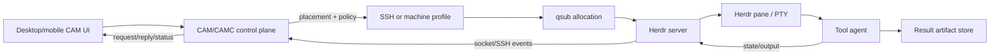

# Herdr Evaluation and CAM Migration Plan

**Date:** 2026-09-22
**Status:** Historical evaluation; implementation direction superseded on 2026-10-14
**Scope:** Evaluate whether Herdr should replace CAMC's tmux-oriented runtime, and define a safe CAM-over-Herdr migration.

**Current decision:** Build independent Rust `cam-server` and `cam-tui`,
leaving existing camc intact. Use Herdr as an implementation reference;
start with a tmux backend and a client-owned history/input/clipboard layer.
The authoritative current plan is
[CAM Server and TUI Plan](2026-10-14-cam-server-and-tui.md).
The recommendations below retain the earlier evaluation for context.

## Executive recommendation

Adopt Herdr as a replaceable terminal/runtime backend, not as a wholesale replacement for CAMC's control plane. The first migration should replace the tmux process/PTY, terminal streaming, attach, and agent-state portions of CAMC with a thin Herdr adapter. CAM/CAMC should continue to own durable requests, routing, tool adapters, qsub/SSH placement, environment and tool-home policy, authorization, retries, result artifacts, and the `camc msg` request/reply contract.

This recommendation is partly based on documented Herdr behavior and partly on engineering judgment:

* **Documented:** Herdr is a Rust server/client binary that owns terminal panes, exposes CLI and socket operations, detects agent state, and supports local or SSH-remote operation. The authoritative references are linked in [Sources and evidence](#sources-and-evidence).
* **Recommendation/inference:** Herdr is a strong replacement for CAMC's tmux backend, but it is not yet a complete durable job/message broker. Keeping CAM's control-plane semantics avoids coupling user workflows to terminal scrollback or a single server connection.
* **Migration guardrail:** Do not retire CAMC until the adapter passes the validation matrix in [Open questions and validation tests](#open-questions-and-validation-tests), including qsub, isolated tool homes, reconnection, and structured request/reply tests.

## Sources and evidence

The links below are primary Herdr documentation or the canonical source repository. Claims in this plan that come from these pages are marked **Documented**; proposed behavior is marked **Recommendation** or **Inference**.

* [Herdr canonical GitHub repository](https://github.com/herdrdev/herdr) — project scope, Rust implementation, binary distribution, and license.
* [How Herdr works](https://herdr.dev/docs/how-to-work/) — server/client model, panes, and interactive workflow.
* [Agents](https://herdr.dev/docs/agents/) — supported integrations and agent lifecycle model.
* [Agent automation](https://herdr.dev/docs/agent-automation/) — `agent prompt`, `agent wait`, status, and automation semantics.
* [Socket API](https://herdr.dev/docs/socket-api/) — local control socket methods and event subscription.
* [Persistence and remote operation](https://herdr.dev/docs/persistence-remote/) — SSH mode, remote binary handling, persistence, and reconnect boundaries.
* [Session state](https://herdr.dev/docs/session-state/) — pane state, scrollback, agent state, and restoration behavior.
* [Configuration](https://herdr.dev/docs/configuration/) and [configuration reference](https://herdr.dev/docs/config-reference/) — shell, pane, environment, and persistence settings.
* [CLI reference](https://herdr.dev/docs/cli-reference/) — list, attach, pane, agent, terminal, and machine commands.
* [Integrations](https://herdr.dev/docs/integrations/) — lifecycle hooks, screen manifests, and custom-agent reporting.
* [Installation](https://herdr.dev/docs/install/) — supported host binaries and installation flow.

The report intentionally does not infer undocumented guarantees such as at-least-once delivery, a complete model transcript, automatic SSH retry, or an Android/mobile native client.

## Conversation timeline

This timeline reconstructs every Herdr-focused round in the conversation. The “answer status” column separates facts found in Herdr documentation from conclusions we should validate in CAM.

| Round | Question raised in the conversation | Answer status and resulting direction |
| --- | --- | --- |
| 1. Herdr versus CAMC/tmux | “研究下 herddev/herdr 看 CAMC 是不是可以 retire 了？” and “看样子应该放弃 tmux 和 camc，采用 herdr 的架构？” | **Recommendation:** do not retire CAMC wholesale. Herdr can replace the terminal/runtime substrate; CAM remains the durable control plane until parity is proven. |
| 2. Backend or new project | “或者把 camc 和 herdr 当作 backend，我们做上一层的东西？” and “应该直接新启动一个 project，基于 herdr，camc 切换到 herdr。” | **Recommendation:** use a backend interface first. A new upper layer can be developed later, but a direct rewrite would discard mature qsub, adapter, API, and message semantics unnecessarily. |
| 3. Terminal and agent variety | “herdr 可以是 kimi 吗？” and “支持任何 terminal 吗？” | **Documented:** Herdr is terminal/pane-oriented and has integrations for several agents; custom agents can report state. **Inference:** arbitrary terminal programs can run, but rich state and prompt automation require a manifest, hook, or explicit reporting integration. |
| 4. Environment reliability | “herdr 怎么解决的 env 问题。” | **Documented:** the Herdr server inherits its launch environment; panes inherit the server environment and can add per-process variables. **Recommendation:** CAM must make environment/tool-home setup explicit, especially inside qsub allocations. |
| 5. Agent transport and management | “herdr 的 agent 通信、管理怎么做的？” | **Documented:** CLI and socket methods operate on panes/agents; reads expose terminal content and detection data. **Boundary:** this is control/terminal transport, not a durable CAM mailbox. |
| 6. List and attach | “怎么 list，怎么 attach。” | **Documented:** Herdr has list/get/read/attach operations and machine profiles for SSH-routed servers. **Recommendation:** CAM's launcher can map its list/attach operations to Herdr, while retaining CAM identities and authorization. |
| 7. Server language and portability | “远程的 server 是用什么语言写的？” and “rust 怎么保证不同机器的通用性的？” | **Documented:** the canonical project is a Rust binary with release targets for common Linux, macOS, and Windows architectures; local/remote protocol capability negotiation reduces exact-version coupling. **Validation:** check the actual supported architecture and protocol generation in the deployment matrix. |
| 8. Status, idle waiting, and agent-to-agent Q&A | “怎么获得 agent 的状态？…wait agent idle…一个 agent 发 message 给另外的 agent，可以做到吗？” | **Documented:** states include working, blocked, done, idle, and unknown; `agent wait` is server-owned and event-driven. **Not documented as a first-class feature:** durable inter-agent mailbox, message IDs, or reply correlation. Keep those in CAM. |
| 9. Auto-confirm and blocked detection | “auto confirm 支持吗？” and “它怎么检测 blocked？” | **Documented:** blocked is a known approval/question screen or lifecycle signal; `agent prompt` refuses to send into a blocked agent. Herdr core intentionally leaves approval to the user; tool-level unsafe flags or third-party approve-all plugins are separate and risky. |
| 10. Response and `camc msg` semantics | “它怎么活到 agent 的 response 的，又 message 吗？” and “又 camc msg 这样的功能吗？比如得到 replay，response=camc msg (‘prompt’)” | **Documented:** prompt acknowledgement and state transitions are available; answers are read from pane output or terminal observation. **Recommendation:** add a CAM request ID, result marker/artifact, timeout, retry, and structured response wrapper above Herdr. |
| 11. History | “history 怎么管理，是 full history 吗？” | **Documented:** pane scrollback is bounded; optional pane-history persistence is separate; native integrations may restore an agent session. **Conclusion:** Herdr is not a full transcript database. CAM should persist task metadata and result artifacts. |
| 12. Shell inheritance and tool directories | “env 怎么管理的，remote shell 是什么？tool dir 怎么管理的？” and “bash…怎么把 csh 的环境继承到 bash 上？” | **Documented:** child processes inherit exported environment values, not csh aliases/functions or arbitrary startup semantics; remote panes use the remote server environment. **Recommendation:** set exported variables before launching Herdr, use explicit pane `--env`/wrappers, and isolate each tool home. |
| 13. Mobile | “herdr 支持 mobile 吗？” | **Documented:** the practical path is an SSH client (for example, Moshi on iPhone) to a host running Herdr; the release binary targets desktop/server OSes, not a native mobile UI. **Recommendation:** treat mobile as a remote terminal client/gateway concern, not a new agent protocol. |

## Architecture findings

### Herdr's documented role

Herdr presents a server/client split around terminal panes. A server owns panes and their processes. A local client renders and controls them, while `herdr --remote <machine>` uses SSH to reach a server on another machine. The remote server, not the local client, owns the process environment and terminal state. The project describes one Rust binary rather than an Electron application; release artifacts cover common Linux, macOS, and Windows hosts ([repository](https://github.com/herdrdev/herdr), [remote docs](https://herdr.dev/docs/persistence-remote/)).

Herdr's automation surface includes:

* pane and agent listing/get/read/attach operations;
* `agent prompt` and `agent wait`, with waits tied to server-side state/events;
* socket methods and event subscriptions for a local control client;
* lifecycle hooks and screen manifests for state detection;
* explicit reporting for custom agents through the pane command and `HERDR_*` environment variables.

These features make Herdr a good runtime boundary for CAM. They do not, by themselves, define a durable distributed queue or a model-independent transcript store.

### Server language and portability

**Documented:** Herdr's canonical implementation is Rust and its distribution model is a single native binary. Local and remote endpoints negotiate protocol capabilities once an endpoint is established; an old pre-generation endpoint may still require an upgrade ([persistence/remote](https://herdr.dev/docs/persistence-remote/)).

**Recommendation:** CAM should pin a minimum Herdr protocol generation and verify it during attach. Distribute the binary for the actual qsub host architecture rather than assuming a developer laptop binary can execute remotely. Keep a compatibility shim for hosts where Herdr is unavailable; the shim should be explicit and observable, not a silent fallback to an unrelated tmux session.

### List and attach model

The Herdr CLI/socket model separates server/pane identity from the process running inside a pane. Names and IDs are scoped to a server. Machine profiles can route commands to a saved SSH destination. A reconnect does not automatically imply retry of an in-flight CAM operation; CAM must decide whether an operation is safe to retry.

**CAM mapping:**

| CAM concept | Herdr-backed implementation | CAM-owned invariant |
| --- | --- | --- |
| agent list | `agent list`/socket `agent.list` plus CAM metadata | Stable CAM agent ID and policy visibility |
| attach | Herdr attach/read/terminal observe | Authorization and selected task identity |
| send prompt | `agent prompt` or lower-level pane input | Request ID, idempotency, timeout, and blocked refusal |
| wait idle/done/blocked | `agent wait`/events | Correlate wait with the intended pane occupant |
| remote placement | Herdr machine/SSH endpoint | qsub project, host, queue, and credential policy |

## Agent state, blocked detection, and Q&A

### State authority

Herdr documents the states `working`, `blocked`, `done`, `idle`, and `unknown`. For supported agents, lifecycle hooks are authoritative when installed and active. Screen manifests are used for agents such as Codex and Claude and inspect the live bottom screen buffer, terminal title, or progress signals rather than arbitrary scrollback. Custom agents can report state explicitly with `pane report-agent`; Herdr supplies `HERDR_ENV`, `HERDR_PANE_ID`, `HERDR_SOCKET_PATH`, and `HERDR_BIN_PATH` to help a wrapper do so ([agents](https://herdr.dev/docs/agents/), [integrations](https://herdr.dev/docs/integrations/)).

The documented `blocked` interpretation is deliberately strict: only known approval, question, or permission UI is considered blocked. If a known agent has no matching rule, a configured known-agent fallback can classify it as idle. This prevents arbitrary text from freezing automation, but it can miss a new prompt shape.

`agent explain <target> --json` (or verbose form) is important for operations: it exposes the manifest, matched rule/evidence, fallback, and skip reason. CAM should record that explanation in diagnostics, while redacting prompt text and secrets.

### Waiting and messages

`agent wait <target> --until idle|done|blocked --timeout ...` is a state wait, not a model-response wait. A prompt can be sent atomically with a delayed Enter and a wait. If the target is blocked, Herdr refuses to send input and reports the blocked condition. A wait may observe an already-active turn; it does not automatically identify a new turn unless CAM adds its own request marker.

Herdr's documented socket/events surface does not replace the following CAM guarantees:

1. a durable request ID and sender/recipient identity;
2. a reply ID that can be fetched after a disconnect;
3. explicit success, failure, timeout, and cancellation states;
4. retry rules that distinguish safe prompt replay from unsafe duplicate actions;
5. a structured result independent of terminal formatting.

Therefore an inter-agent request should be a CAM message whose payload asks the destination agent to write a result artifact and emit a unique completion marker. Herdr carries the prompt, state, and terminal bytes; CAM records the envelope and artifact location.

## Auto-confirm and safety boundaries

Herdr core treats a blocked screen as a user decision. This is a useful safety boundary for CAM: a blocked prompt should not be silently answered. Tool-specific flags can change the underlying agent's behavior (for example, Codex `--yolo` or Claude `--dangerously-skip-permissions`), but those are policy decisions made by the CAM adapter, not Herdr's global auto-confirm facility. A third-party approve-all plugin that sends Enter indiscriminately is not an acceptable default for production automation.

The proposed policy is:

* default: do not auto-confirm; expose `blocked` with evidence and let CAM/UI ask for approval;
* controlled unattended profile: require an explicit per-tool/per-project policy, record the unsafe flag, and limit the qsub identity and filesystem scope;
* never treat a generic Enter loop as a substitute for state detection;
* if Herdr reports `unknown`, fail closed for destructive or privileged actions.

## History and response semantics

Herdr provides bounded pane scrollback and optional pane-history persistence. The persisted screen history is not equivalent to a complete model transcript, and a server restart restores layout/process metadata only within the documented limits. Native agent integrations can restore their own sessions (for example, through a tool's resume mechanism); the tool remains the authority for full conversation history ([session state](https://herdr.dev/docs/session-state/)).

The proposed response path is:

1. CAM creates `request_id`, sender, recipient, tool, project, and a result-artifact path.
2. CAM resolves or starts a Herdr pane and records the Herdr server/pane occupant.
3. CAM sends a prompt containing a short request ID and artifact contract.
4. Herdr acknowledges input and emits state/output events; CAM waits for `idle`/`done` or timeout.
5. The agent writes structured JSON/Markdown to the artifact path and prints a completion marker containing the request ID.
6. CAM validates the marker, reads the artifact, and stores a durable reply envelope. If the connection drops, CAM can resume by request ID without treating terminal scrollback as the source of truth.

This keeps the useful `response = camc msg("prompt")` experience while making the response durable and machine-readable.

## Environment, shell, tool-home, and qsub implications

### Inheritance rules

The process that launches the Herdr server defines the baseline environment. New panes inherit that environment and can receive additional variables through Herdr's per-process environment option. Existing panes do not change when the configuration changes. Remote mode uses the remote server's environment; local `PATH`, aliases, functions, and tool-home variables are not copied automatically.

For csh to bash inheritance, exported values (`setenv VAR value`) are inherited by child processes. csh aliases, shell functions, and csh startup-file behavior are not converted into bash. A bash login shell may add or overwrite `PATH`. The robust sequence is:

```text
csh launcher: setenv PATH "$HOME/.local/bin:$PATH"
csh launcher: setenv CODEX_HOME "$HOME/.codex/agent-a"
csh launcher: exec herdr
Herdr pane: bash -lc 'command -v codex; printf "%s\\n" "$CODEX_HOME"'
```

CAM should prefer an explicit wrapper or pane `--env` for reproducibility and should log only safe, non-secret environment facts.

### Tool homes

Herdr does not provide one universal tool-home isolation policy. CAM adapters should own it. Examples of tool-specific variables include:

| Tool | Home variable/default | CAM rule |
| --- | --- | --- |
| Codex | `CODEX_HOME`, normally `~/.codex` | Allocate a per-agent directory when concurrent sessions or session locks could collide. |
| Claude | `CLAUDE_CONFIG_DIR`, normally `~/.claude` | Isolate credentials/config when policy requires it; never copy tokens into a pane command. |
| Pi | `PI_CODING_AGENT_DIR`, normally `~/.pi/agent` | Generate the directory before launch and test settings/model discovery in the target host. |
| Other tools | Tool-specific home variables | Adapter declares the variable and whether isolation is required. |

The adapter option should remain tool-neutral (for example, an `isolate_tool_home` boolean or tri-state policy) while the tool adapter supplies its default. This avoids hard-coding Codex behavior into Herdr itself.

### qsub placement

The qsub allocation is an execution boundary, not merely a long SSH session. If Herdr starts outside the allocation, panes may not see the allocation's `PATH`, libraries, scheduler variables, or filesystem mounts. The safe design is:

```text
CAM control plane
  -> qsub allocation (project/queue/resource policy)
      -> exported PATH + tool-home wrapper
          -> Herdr server
              -> pane/process -> tool agent
```

At startup, the wrapper should verify `command -v herdr`, `command -v codex`/`claude`/`pi`, the resolved tool home, scheduler identity, and project. If verification fails, leave the Herdr server reachable with a clear diagnostic rather than claiming that the agent started. CAM may use SSH to reach a known allocation host, but it must not assume that host is interchangeable with the original LSF cgroup. The `qsub` last-resort path remains CAM policy, not Herdr behavior.

## Mobile and remote use

Herdr's practical mobile story is SSH: connect from a phone to the host running Herdr and run the terminal client. A narrow TUI can adapt to a phone-sized terminal; the official native binary distribution should not be treated as an Android/iOS app. A qsub-backed agent additionally requires a routable SSH path (possibly a gateway) to the allocation host. CAM's mobile layer should therefore talk to the same CAM/Herdr endpoint and present durable tasks/status, while SSH remains a fallback for raw attach/debugging.

## Capability matrix

| Capability | Herdr documented support | CAM/CAMC responsibility after migration | Acceptance criterion |
| --- | --- | --- | --- |
| PTY/process lifecycle | Panes own processes and terminal sessions | Placement policy, cleanup policy, ownership | Start/stop/restart without orphaned panes |
| Local attach | CLI/UI attach and terminal observation | CAM auth and stable agent identity | Attach to the intended occupant after a list/refresh |
| Remote attach | SSH machine profiles and `--remote` | Host/project selection, gateway, retries | Reconnect to a known server without duplicate task launch |
| Agent list/get/read | CLI and socket methods | Durable metadata and filtering | List reports CAM ID, Herdr ID, tool, project, state |
| State | working/blocked/done/idle/unknown, hooks/manifests | Policy, evidence storage, conservative fallbacks | Fixtures cover every state and unknown behavior |
| Wait | Event/state wait with timeout | Request correlation and cancellation | Wait pins the intended pane occupant |
| Prompt | Prompt plus optional wait; refuses blocked target | Request envelope, idempotency, policy | Duplicate delivery is detected or explicitly rejected |
| Terminal output | Visible/recent/detection or live observation | Redaction and artifact extraction | No secret/raw-command persistence |
| Inter-agent message/reply | No documented durable mailbox contract | `camc msg`/CAM mailbox | Reply fetches by request ID after reconnect |
| Full history | Bounded scrollback/optional screen history; tool owns full transcript | Task/reply artifacts and retention | A response is available without scrollback |
| Auto-confirm | No safe global default | Per-tool policy and approvals | Blocked prompts fail closed by default |
| Environment | Server inheritance, per-process env | Adapter profiles, wrappers, qsub | `command -v` and home checks pass inside allocation |
| Mobile | SSH terminal route | Mobile UI/API and gateway policy | Status/list works on phone without exposing credentials |

## Protocol and data-flow diagrams

### Runtime data flow



### CAM message over Herdr

```text
CAM sender
   |  request_id, recipient, prompt, artifact contract
   v
CAM router/policy ---- durable envelope ----> CAM reply store
   |
   | Herdr agent.prompt (only if state is safe)
   v
Herdr server -> pane -> tool agent
   |              |
   |              +--> structured result artifact
   +--> state/output events
   |
CAM waits for pinned pane + marker/artifact
   v
CAM reply(request_id, status, artifact, diagnostics)
```

### State and safety flow

```text
working  --agent completes--> idle/done
working  --known approval--> blocked --explicit approval--> working
working  --unknown evidence--> unknown --operator/CAM policy--> inspect or stop
any state --disconnect--> transport_lost (CAM state; do not duplicate prompt)
```

The `transport_lost` state is a proposed CAM state, not a Herdr state. It makes the retry decision explicit.

## Proposed CAM-over-Herdr layering

### Layer 1: Herdr runtime adapter

Implement a narrow interface such as:

```text
start(spec) -> {server, pane, occupant}
list(filter) -> panes/agents
attach(target) -> terminal stream
prompt(target, request) -> acknowledgement
wait(target, states, timeout) -> state/evidence
stop(target, policy) -> result
```

The adapter owns Herdr CLI/socket invocation, protocol capability checks, event decoding, and redaction. It must not silently mix a different server or an old pane occupant into a CAM agent record.

### Layer 2: CAM control plane

Keep CAM's existing responsibilities: adapter selection, tool launcher presets, qsub/SSH selection, project validation, API-profile policy, isolated tool homes, request/reply persistence, retries, cleanup, and user-facing diagnostics. `camc msg` becomes a transport-neutral message API whose default runtime is Herdr.

### Layer 3: UI/mobile clients

Desktop, web, and mobile clients consume CAM task/status/reply APIs. They may expose an “attach terminal” action that uses Herdr, but they should not need to parse Herdr screen output to decide whether a task completed.

### Compatibility backend

Retain the current tmux backend only during migration and behind the same interface. Mark it legacy, add telemetry for backend selection and failures, and remove it only after the parity gates pass. This is safer than changing every CAM caller at once.

## Phased implementation plan

### Phase 0 — evidence and compatibility spike

* Pin a supported Herdr release/protocol generation.
* Build a Linux x86_64 and aarch64 test matrix plus one macOS/Windows client check where available.
* Verify local server, `--remote`, machine profile, list, attach, read, prompt, wait, and disconnect behavior.
* Record which claims are documented versus observed; do not infer delivery guarantees from a successful interactive demo.

**Exit gate:** a scripted smoke test can start a harmless shell, observe state, wait, reconnect, and clean up without using real secrets or submitting production qsub work.

### Phase 1 — runtime adapter

* Add the Herdr backend behind the existing CAM runtime interface.
* Pin the pane occupant and server identity at start; reject a changed occupant on reuse.
* Translate Herdr state/evidence to CAM states and preserve `unknown`.
* Keep tmux as an explicit fallback for a short compatibility window.

**Exit gate:** existing local CAM workflows pass against both backends with equivalent lifecycle results.

### Phase 2 — durable message wrapper

* Add request/reply IDs, sender/recipient, timeout, cancellation, and retry policy.
* Require a result artifact and completion marker for automated inter-agent requests.
* Store only safe metadata and artifact references; redact prompt, token, and terminal-secret content.
* Make blocked prompts return a structured approval-needed result.

**Exit gate:** disconnecting the client does not lose a completed reply or cause an unsafe duplicate prompt.

### Phase 3 — environment, tool homes, and qsub

* Add adapter-declared tool-home isolation defaults.
* Generate wrappers that export PATH and homes before starting Herdr inside the allocation.
* Validate project/queue/host and run `command -v` checks in the real pane.
* Add explicit `--no-default-api` or equivalent policy where a loopback API profile is unsafe on a remote host.

**Exit gate:** Codex, Claude, and Pi fixtures start in separate homes from csh and bash launchers inside a qsub test allocation.

### Phase 4 — mobile and operations

* Expose CAM status/list/reply APIs to the desktop/mobile client.
* Keep SSH attach as an operator escape hatch with short-lived credentials and host-key verification.
* Add metrics for state-detection fallback, transport loss, prompt refusal, and qsub fallback.

**Exit gate:** phone access can inspect status and fetch a reply without requiring raw shell credentials; SSH attach remains an explicitly privileged operation.

### Phase 5 — retire tmux backend

* Run a soak period with Herdr as default and tmux opt-in.
* Compare lifecycle, state, latency, reconnect, and cleanup metrics.
* Remove tmux only after the migration checklist is signed off and a rollback package is available.

## Security and reliability risks

| Risk | Why it matters | Mitigation |
| --- | --- | --- |
| Screen-state false negative | A new prompt shape may be classified idle and receive no response, or an unsafe action may be attempted | Use lifecycle hooks where available, inspect `agent explain`, preserve unknown, and test prompt fixtures on every tool upgrade |
| Terminal text contains secrets | Scrollback/events can include tokens, source, or commands | Redact at adapter boundary; persist artifacts/metadata only; bound retention |
| Duplicate prompt after reconnect | A retry can repeat a destructive action | Request IDs, completion markers, pinned occupants, and per-command idempotency policy |
| qsub/cgroup mismatch | SSH may reach a host without the original allocation context | Start Herdr inside allocation; validate scheduler identity and environment; treat host reuse as best-effort |
| Tool-home collision | Concurrent sessions can corrupt locks/config/history | Adapter-declared isolated homes and explicit cleanup/retention |
| Unsafe auto-confirm | Blind Enter can approve destructive operations | Default blocked refusal; explicit policy and audit for unsafe tool flags |
| Remote binary/version mismatch | Client/server capabilities can diverge | Pin protocol generation, verify at attach, install known binary, fail clearly |
| SSH credential exposure | Mobile/raw attach broadens access | Host-key checking, short-lived credentials, least privilege, CAM authorization before attach |
| Persistence assumptions | Herdr screen history is not a durable transcript | CAM result artifacts and reply store are authoritative |
| tmux fallback drift | Two backends can produce inconsistent state semantics | Shared contract tests and explicit backend in diagnostics |

## Open questions and validation tests

The following are deliberately open until tested against the selected Herdr release and our deployment hosts:

1. Which exact Herdr release/protocol generation is approved for production, and how are upgrades rolled back?
2. Does the socket endpoint remain reachable through the intended SSH gateway and qsub host firewall policy?
3. What is the observed reconnect behavior for a prompt that was sent immediately before a network loss?
4. Which Codex, Claude, Pi, Kimi, and future tool versions have lifecycle hooks versus screen-only detection?
5. How large can safe `recent`/`recent-unwrapped` reads be before latency or memory becomes operationally significant?
6. What retention and encryption policy applies to result artifacts and optional pane history?
7. Can a qsub allocation launch a Herdr server without a login shell changing PATH or scheduler variables?
8. Which mobile gateway topology is approved, and can it expose CAM status without exposing an interactive shell?

Required tests (all must avoid real secrets, destructive commands, and production qsub submissions):

* parse/list/attach against a mocked Herdr CLI and socket server;
* state fixtures for working, idle, done, blocked, unknown, lifecycle hook, screen manifest, and fallback evidence;
* prompt refusal while blocked and successful prompt after explicit approval;
* wait pinning when a pane is recycled or another agent starts on the same server;
* request/reply marker and artifact retrieval after client disconnect/reconnect;
* duplicate request, timeout, cancellation, and safe retry behavior;
* local versus `--remote` environment comparison, including `command -v` and tool homes;
* csh `setenv` to bash child inheritance, login-shell PATH changes, and explicit pane `--env` overrides;
* qsub allocation launch with project/queue identity and cleanup after process exit;
* isolated Codex/Claude/Pi homes with concurrent agents and simulated lock files;
* protocol/version mismatch and missing remote binary error paths;
* SSH host-key failure, unreachable host, and gateway disconnect;
* bounded scrollback and optional history redaction;
* mobile-sized terminal rendering plus CAM API-only status/reply access.

## Explicit decision

Proceed with a CAM-over-Herdr integration and stop treating tmux as the long-term runtime abstraction. Do **not** delete CAMC or replace its message/control plane in this phase. Herdr should be the first backend implementation behind a stable CAM runtime interface; CAM should remain authoritative for durable work, policy, qsub/SSH placement, tool-home/environment construction, and structured replies. Retire the tmux backend only after the phased gates and validation tests above pass on the actual host and scheduler environments.
