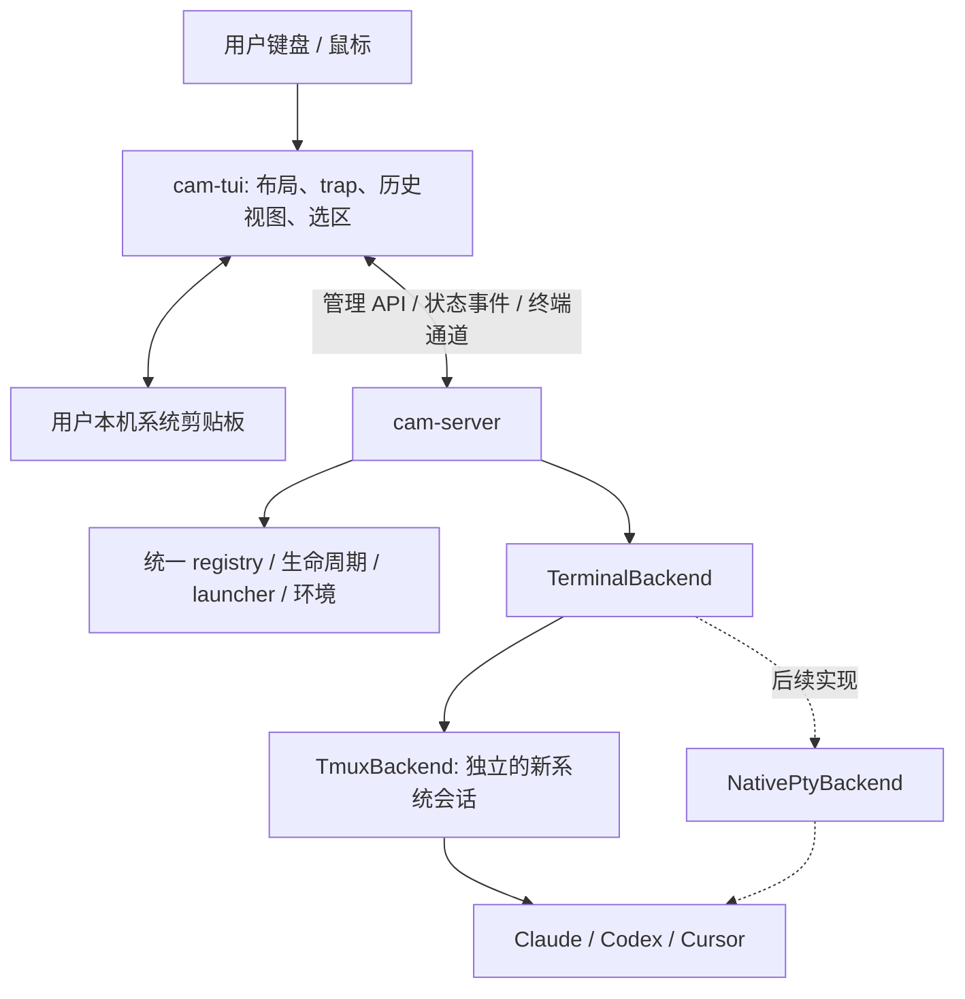

# CAM Server and TUI Plan

**日期：** 2026-10-14

**状态：** 已确定架构方向；尚未实现

**范围：** 独立开发 Rust `cam-server`、`cam-tui` 和共享协议，参考 Herdr；现有 camc 继续使用。

> 2026-10-18 架构更新：角色、camc 的 legacy Client 定位、Server runtime ownership
> 和多 Client 中继拓扑以 [CAM Client / Server Spec](../../cam-client-server-spec.md)
> 为准。本文保留终端后端、trap 和早期分阶段研究；下文的“不接管 camc”是迁移前
> 隔离要求，不排除新 Spec 规定的受控迁移与最终替代。
> 迁移采用渐进方式：agent 信息管理和执行能力逐步进入 Server，camc 保留 fallback；
> TUI/Desktop/Mobile 按能力切换，不先删除旧工作流。

## 1. 已确定的目标

1. 使用 Rust 重构新系统，具备真正的 TUI、键盘和鼠标处理能力。
2. 每台机器、每个用户一个 CAM server，统一管理该用户的全部新系统 agent。
3. cam-tui/CLI 与 server 通信，客户端不自行扫描 tmux socket、进程或 registry。
4. 在 tmux 与用户界面之间建立客户端 trap 层，接管 PageUp/PageDown、滚轮、历史浏览、选区、copy/paste。
5. 第一阶段保留 tmux 作为后端，通过适配器封装；后续可增加原生 PTY 后端。
6. 新系统与 camc 并行运行，不接管 camc 的 registry、monitor、socket 或已有会话，也不修改 camc 的启动入口。

主要验收目标是交互体验：用户能够直接浏览历史、稳定拖选，并复制到本机系统剪贴板，不需要操作 tmux copy mode。

## 2. 组件与职责

建议建立独立 Cargo workspace，具体目录在实施时确定：

```text
cam-server    常驻管理进程；每台机器、每个用户一份
cam-tui       用户本机上的 TUI；可连接多个 server
cam-protocol  共享请求、响应、事件和协议版本定义
```



### cam-server

- agent ID、名称、工作区、session、状态、退出原因和执行位置的权威来源。
- 集中处理启动、停止、reboot、输入、resize、历史读取及资源回收。
- 统一驱动状态检测和事件发布，不为每个 agent 启动独立的 monitor 进程。
- 管理 launcher、tool resolve、环境、API profile 和独立 tool home。
- 管理终端后端，但不负责用户本机的鼠标选区和系统剪贴板。
- 一个 agent 只有一个 owner server；操作通过该 server 执行。

### cam-tui

- Herdr 风格的工作区侧栏、agent 列表、终端标签和状态提示。
- 多机器状态由客户端汇总，各节点 server 保持各自的权威状态。
- 负责输入 trap、实时终端显示、历史视图、搜索、选区和本机剪贴板。
- 断线时明确显示缓存状态，不能把缓存当作实时状态。
- 客户端退出不停止 agent；重新连接时同步快照及后续事件。

管理状态集中在 server，并不要求所有 UI 状态都放在 server。客户端自己的 viewport、选区、主题和布局偏好独立维护。

## 3. Herdr server 的源码参考

此次阅读的上游源码版本为
[`6521382dbed36f2d001417108149c338aee116ea`](https://github.com/herdrdev/herdr/tree/6521382dbed36f2d001417108149c338aee116ea)。
下面描述的是该版本已读源码中的实现；我们的设计建议另列。

| Herdr 实现 | 源码入口 | 对 CAM 的启发 |
|---|---|---|
| HeadlessServer 持有统一 App 状态，并驱动事件循环 | [bootstrap.rs](https://github.com/herdrdev/herdr/blob/6521382dbed36f2d001417108149c338aee116ea/src/server/headless/bootstrap.rs)、[headless.rs](https://github.com/herdrdev/herdr/blob/6521382dbed36f2d001417108149c338aee116ea/src/server/headless.rs) | server 集中管理，客户端通过接口读取 |
| JSON 管理 API 与交互客户端连接分开 | [client_transport.rs](https://github.com/herdrdev/herdr/blob/6521382dbed36f2d001417108149c338aee116ea/src/server/client_transport.rs)、[socket_paths.rs](https://github.com/herdrdev/herdr/blob/6521382dbed36f2d001417108149c338aee116ea/src/server/socket_paths.rs) | 管理请求与大量终端输出分离，避免相互阻塞 |
| portable-pty 直接托管终端进程，PTY I/O actor 处理读写、resize、退出 | [backend/unix.rs](https://github.com/herdrdev/herdr/blob/6521382dbed36f2d001417108149c338aee116ea/src/pty/backend/unix.rs)、[actor/unix.rs](https://github.com/herdrdev/herdr/blob/6521382dbed36f2d001417108149c338aee116ea/src/pty/actor/unix.rs) | 后续原生 PTY 后端的参考；Herdr 自身不依赖 tmux |
| server 维护终端解析后的屏幕及历史 | [pane/terminal.rs](https://github.com/herdrdev/herdr/blob/6521382dbed36f2d001417108149c338aee116ea/src/pane/terminal.rs) | 不把终端重绘输出当作普通文本追加 |
| server 提供 agent 列表，client 汇总多 endpoint | [api/agents.rs](https://github.com/herdrdev/herdr/blob/6521382dbed36f2d001417108149c338aee116ea/src/app/api/agents.rs)、[client/shell/endpoints.rs](https://github.com/herdrdev/herdr/blob/6521382dbed36f2d001417108149c338aee116ea/src/client/shell/endpoints.rs) | 节点内集中管理，跨节点在 client 展示 |
| session 快照和可选屏幕历史保存为独立 JSON 文件 | [persist.rs](https://github.com/herdrdev/herdr/blob/6521382dbed36f2d001417108149c338aee116ea/src/persist.rs) | 第一版不强制引入数据库服务 |

Herdr 是一个命名 session 对应一个 server，一台机器可以有多个 server。CAM 的目标则是每台机器、每个用户一个 server，在它内部管理多个工作区和 agent。

技术栈建议参考其 Rust、Tokio、ratatui、crossterm；portable-pty 和终端解析组件用于后续原生运行时。具体依赖版本、最低 glibc 和目标平台必须先验证，不直接照抄上游版本。

## 4. 终端后端与 trap 层

### 第一阶段：TmuxBackend

- server 管理新系统自己的 tmux 会话、socket 和进程信息。
- 初期允许每个 agent 独立 tmux server；是否合并由后续测试决定。
- 通过 tmux CLI/control mode 访问后端，不直接实现 tmux 内部 socket 协议。
- attach、input、resize、read-history、exit-events 封装在后端接口中。
- tmux 服务于进程托管和数据获取，不承担用户侧选择与复制 UX。
- tmux 的运行状态与 agent 的工作状态分别记录，不把“tmux 存活”当作“agent 正常”。

### trap 接管规则

| 用户操作 | 客户端行为 | 是否透传给 agent |
|---|---|---|
| PageUp/PageDown、滚轮 | 移动客户端历史 viewport，暂停自动跟随 | 否 |
| 拖选文字 | 客户端绘制选区，松开后保留 | 否 |
| Copy | 提取客户端选区，调用本机剪贴板 API | 否 |
| Paste | 读取本机剪贴板，按终端能力编码 bracketed paste | 编码后发送 |
| 返回实时画面 | 退出历史视图并恢复跟随 | 否 |
| 普通输入、未被占用的按键 | 正常输入通道 | 是 |

trap 不能只拦截按键，还要有独立的显示状态和历史缓冲区。终端输出须正确解析光标移动、清屏、重绘和备用屏幕；不能用字符串累积代替终端模型。

客户端 history view 按需从 server 获取历史，使用稳定的历史游标/版本区分新输出和旧数据，避免重连后重复追加。滚动期间后台 agent 继续运行，新输出不能把用户拉回底部。窗口 resize、换行重排和 Unicode 字符必须有明确的选区处理规则。

终端历史与完整模型对话不是同一份数据。后续可增加从工具原生 session 文件读取的 Conversation view，不能把 terminal scrollback 宣称为完整对话记录。

### 系统剪贴板边界

- cam-tui 优先运行在用户本机，server 可以远程运行。
- 只有本机剪贴板写入成功后显示“已复制”；失败时明确提示，不以 tmux buffer 写入作为成功。
- 如果用户先 SSH 到远端再启动 cam-tui，本机剪贴板仍依赖外层终端能力，例如 OSC 52；这一模式不能承诺与本地 TUI 相同的剪贴板保证。
- 原型必须验证真实用户终端里的复制、粘贴，不能只验证内部 buffer 或配置语法。

## 5. 通信、所有权与恢复

### 通信

- 本机使用 owner-only Unix socket；远端第一版通过 SSH 通道访问，暂不要求开放网络端口。
- 管理 API 和交互终端通道明确分离；可使用两个 socket 或独立逻辑通道，实施前确定协议。
- 请求包含 request ID；响应、事件包含 agent ID、owner server 和 server 启动代次。
- 首次连接或重连获取状态快照，再订阅增量事件。事件需要序号和可检测的丢失边界。
- 启动、reboot 等修改操作要有去重/结果查询；连接断开后不能盲目重发并创建重复 agent/job。
- 慢客户端的终端输出有背压及缓存上限，不能阻塞管理请求，也不能导致无限内存增长。

### 持久化与恢复

- 第一版持久化格式可使用原子写入的 JSON 快照，也可使用节点本地 SQLite；此项尚待实现评估，不引入外部数据库服务。
- 持久状态、临时 socket、节点本地运行状态分开；锁和实时 SQLite 不放共享 NFS。
- 使用新系统自己的目录和 namespace。建议命名为 `cam-server`，不得复用现有 `~/.cam` registry 或 `/tmp/cam-sockets`。
- TmuxBackend 下，server 重启后重新关联并核验自己的已有 agent，不误杀、不重复启动。
- NativePtyBackend 下，普通 server 重启不承诺原进程存活；native resume 与未来 FD handoff 要明确区分。
- 多 client 连接时，明确哪个 client 可以输入和调整 terminal geometry；历史浏览和选区不影响其他 client。

## 6. 分阶段实施与验收

### 阶段 A：独立骨架

- 新 Cargo workspace、共享协议、一个 server 和一个 TUI。
- server socket、状态快照、事件订阅及明确的启动/退出行为。
- 用户本机 TUI 与目标 Linux 节点的构建、运行兼容性验证。

**验收：** 不修改 camc；可以连接、断开、重连；权限、协议不匹配和重复 server 启动有明确结果。

### 阶段 B：一个 agent 与交互体验

- 一个独立测试工作区、一份 agent，通过 TmuxBackend 启动。
- 实时终端、history viewport、PageUp/PageDown、滚轮、拖选、copy/paste。
- 输入透传、terminal resize、停止和清理。

**验收：** 用户不需要 tmux copy mode；选区稳定；实际系统剪贴板可粘贴；Unicode、多行与长文本正常；历史浏览不被新输出打断；客户端关闭后 agent 继续运行；重连恢复显示；测试资源全部回收。

### 阶段 C：集中管理与 Herdr 风格界面

- 多工作区、多 agent、侧栏、标签、状态和退出原因。
- agent start/list/get/stop/reboot 由 server 执行。
- 用集中调度替代每 agent 独立 monitor，区分进程状态、工具状态与连接状态。

**验收：** 多 client 显示一致；一个修改操作只执行一次；server 重启后恢复 tmux 管理；正常关闭与崩溃恢复分别测试。

### 阶段 D：远端 server 与多机器

- 本机 cam-tui 通过 SSH 连接 PRGN、DC7 等 server。
- 各 server 提供各自状态，client 合并显示；断线重连不影响其他机器。
- 当前机器/pane 的输入目标和 resize 所有权必须清晰。

**验收：** 一台机器断线不阻塞其他机器；断线缓存标明 stale；复制仍写本机剪贴板；远端退出不会造成 client 假成功。

### 阶段 E：NV launcher 与工具策略

- 迁移 `self → battach → ssh → qsub → local`、nvproject、tool resolve、环境和 tool-home 策略。
- 保留显式自定义 launcher 的用户责任边界，以及 local fallback 不附加 launcher autorun 的行为。
- 区分 owner server、submit host、execution host、LSF job ID；控制所有权不等同于 allocation/cgroup 身份。
- 复用原 allocation 时不提交嵌套 qsub；回收仅作用于新系统拥有的 agent/job。
- Claude/Codex 的登录与 API 配置必须在实际目标环境验证。

**验收：** 本地、PRGN、DC7 命令行和 TUI 测试；逐项覆盖实际 fallback、无重复提交、reboot、断线和回收。未跑过的路径必须明确标注，不能据其他路径通过而宣称通过。

### 后续阶段

- NativePtyBackend，参考 Herdr 的 PTY actor、终端解析与事件循环。
- 消息/mailbox、cron、prompt/goal loop、跨机器路由和现有自动化接口的迁移。
- 新系统达到既有工作流的能力与稳定性要求后，由用户决定是否迁移和退役 camc。

## 7. 实施前需落定的事项

- 首个用户客户端平台，以及本机剪贴板实现与实际测试终端。
- 管理/终端协议、历史游标、背压与输入所有权的具体定义。
- tmux 输出解析和历史获取方案；第一版不实现自定义 tmux socket 协议。
- 新系统的状态路径及持久化格式。
- LSF 远端执行下 owner server 与 execution server 的注册边界，确保无重复管理。
- Rust 和终端解析依赖的目标平台兼容性。

这些是后续实施选择，不改变已经确定的方向：独立 Rust server/TUI、节点内集中管理、客户端交互接管、现有 camc 保持可用。
