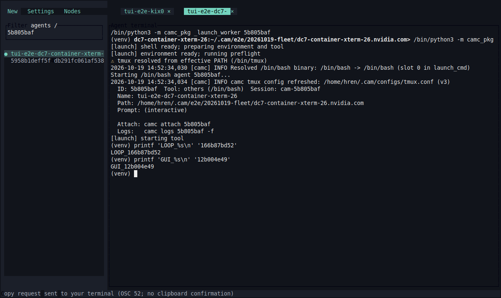

# CAM TUI 跨机器部署与 E2E，2026-10-19

分支 `cam-tui`，基于 `06471f7` 加当前工作区改动。未 commit/push。

本文保留首轮 v1.2.187 的部署与实测记录；后续降为 30 秒轮询、原生 X11 剪贴板、任务编辑及完整功能补测见 [功能验收补测](cam-tui-features-20261019.md)。

## 部署结果

更新当前用户的 7 个可连接 ITSS/VNC Node：SITE-A046/064/086/106、SITE-B001/009、SITE-C。
每台一个 `cam-server serve`，本机 SITE-A046 一个 `cam-clientd`，一个真实 VNC xterm/TUI。
不把共享 NFS Home 误当成所有站点统一的 Home；SITE-A、SITE-B、SITE-F 分别部署并校验。

- camc：`1.2.187`，`~/.cam/camc`，已有个人 bin 别名保持指向该文件。
- Rust Server/Client daemon/TUI：`0.1.0`，Linux x86_64 musl 静态二进制，无系统 glibc 依赖。
- SDK 保存在每个 release 的 `sdk/`，Server 直接调用 SDK，不经 camc CLI 派发管理业务。
- 后端 Python：SITE-A/SITE-C 3.6.8，SITE-B 3.12.2；tmux/tool 仍是后端依赖。
- Release：`cam-20261019-v1.2.187-49a01394ae`。
- 内容清单 SHA-256：`49a01394aebd34cdd5230b57898ff74b54c3fbfbe4ccc9ee508b8d8cd4f14d61`。7 台均核对全部 63 个文件及个人 bin 哈希。
- Server 配置、token 私有化；每个 Node 独立 Node ID/token，Client 只获得显式 management grant。
- 本机 GUI：VNC `:171`（7171 端口），窗口 `CAM TUI Fleet`。
- 当前个人路径已更新；本次未改其它用户或共享工具安装。

两个入口在直接 SSH 和站点内 SSH 重试后仍不可达，因此未部署：

| Node | 入口 | 阻塞 |
| --- | --- | --- |
| SITE-B014 | node.example.com:2263 | 握手连接被关闭 |
| SITE-D | node.example.com:3255 | 当前公钥不被接受 |

## daemon 降频

普通状态快照默认由 2 秒改为 15 秒，`poll_seconds` 可配置。
修改 agent 后立即刷新相关 Node；capture/status 不触发额外同步。
只有本 daemon 新发起的 run/reboot，或新连接但尚未取得快照的 Node，临时每 2 秒刷新。
历史 initializing 记录不会持续触发快速轮询。新 agent started/dead 或 stop/kill/remove 后结束快速刷新；另有 600 秒上限。
缓存 stale 和路由 metadata TTL 随普通轮询间隔调整。
心跳、任务调度时钟仍独立，不等同于远端 agent 状态扫描。

真实 32 秒观察中，7 个 Node 都只出现两次同步更新；普通间隔为 15 秒。

## 验证

| 检查 | 结果 |
| --- | --- |
| Python 全套 | 1714 passed，1 skipped，12 个已有 deprecation warnings |
| Launcher/binder focused | 177 passed |
| Rust workspace 单元测试 | 16 passed |
| 最终真实 Server/daemon/tmux/PTY 进程回归 | 24 passed，60.950 秒；包括慢轮询、新启动快速刷新、取消启动后停止快速刷新 |
| Python 3.6 grammar | camc_pkg 34 个文件通过 |
| Rustfmt、git diff --check | 通过 |
| 七节点 bash agent | run 到 started、status、capture、terminal attach/input/resize、send、key 全部通过 |
| 七节点生命周期 | stop→stopped、同 ID reboot→started、保存的 bash 参数生效、kill→killed、再次 reboot 全部通过 |
| 七节点原生 camc 环路 | 每个 Node 向下一个 Node 执行 status/capture，stdout 返回，全部通过；2.399–6.356 秒/组 |
| 三轮 mailbox | SITE-A→SITE-B、SITE-A→SITE-C request/reply/再 reply，thread 与独立 message ID 正确 |
| 真实 scheduler/loop | 本地一次性任务执行后禁用，SITE-C idle loop 触发一次，随后活动窗口内 deferred；测试任务已删除 |
| Node 重连 | SITE-B 断开后 stale、重新连接后恢复新鲜快照，通过 |
| camc version 延迟 | 5 次 16.5/2.2/2.1/2.4/2.7 ms，中位 2.4 ms |

开发过程中观察到的两类失败已单独处理：旧测试 ID 重用以及读取 reboot 前的旧 dead 缓存，属于测试脚本条件错误；已改用新 ID/等待本轮状态后重测。
并行生命周期测试曾出现一次 AGENT_NOT_FOUND，随后完整七节点复测全部通过；共享 NFS registry 的暂态一致性仍值得持续关注。
构建脚本验证器因开发版与 bundle 版本 stamp 不同返回差异；本次未修改该无关比较逻辑。最终版本、包内容与部署哈希另行校验。

### 真正的 Claude/Codex

测试均走 `auto`，没有在普通主机绕过 LSF 执行 LLM。PASS 必须观察到模型实际返回随机拼接 token，且 agent alive/started；仅启动 CLI 不算通过。
SITE-A/SITE-F battach 实际进程中验证了显式 tool-env 测试标记；Claude 的 DISABLE_AUTOUPDATER=1 也可见。

| Node | Codex | Claude |
| --- | --- | --- |
| site-a-container-xterm-046 | PASS / battach | PASS / battach |
| site-c-container-xterm-26 | PASS / battach；测试隔离配置改选可用 gpt-5.6-sol | BLOCKED：Not logged in |
| site-b01-container-xterm-001 | BLOCKED：原 ~/.codex/config.toml 有重复 hooks.state 表 | BLOCKED：Not logged in；qsub 已成功进入工具 |
| site-b01-container-xterm-009 | BLOCKED：原 ~/.codex/config.toml 有重复 hooks.state 表 | BLOCKED：Not logged in；qsub 已成功进入工具 |
| site-a-container-xterm-064 | PASS / battach | PASS / battach |
| site-a-container-xterm-086 | PASS / battach | PASS / battach |
| site-a-container-xterm-106 | PASS / battach | PASS / battach |

四个 SITE-A Node 的两个工具全部返回真实模型结果，通常约 19–44 秒。SITE-C Codex 原默认模型 gpt-5.6-luna 被 ChatGPT 账号拒绝；在该测试 agent 的隔离配置中选其菜单公布的 gpt-5.6-sol 后返回结果，未改用户原配置。
SITE-B 的原 Codex 配置经 TOML parser 独立验证确有重复表；未改写用户原配置。Claude 在 SITE-B/SITE-C 显示 Not logged in，需要用户完成登录后补测。整套 LLM E2E 尚未全绿。

### 实际 GUI

在本机真实 xterm/VNC 窗口通过鼠标筛选并打开 SITE-B 与 SITE-C 测试 bash agent，两个 tab 分别输入 printf，目标 capture 观察到正确结果。
实际查看了 PageUp/PageDown、滚轮、End 返回实时、鼠标释放后选区保留的截图。
复制后 UI 正确显示“Copy request sent … no clipboard confirmation”；X11 检查没有确认本次 xterm 持有 CLIPBOARD，系统复制/粘贴不能记为通过。当前机器缺少 xclip；原生剪贴板依赖或用户终端的 OSC 52 支持仍需补齐。
为该测试 xterm 显式设置配色资源；未改用户全局 tmux/终端配置。

## 本次必要修复

1. Rust daemon 自适应降频及取消启动后的 watch 清理。
2. Launcher 转发用户显式 tool-env，继续排除未请求的主机环境变量；PATH 仍保留 allocation 环境合并。
3. SDK/module 启动 Codex session binder 使用 Python -m，避免对 __main__.py 直接 exec 的权限错误。
4. 一个参数解析单测隔离真实 Server 发现；补充 adapter/launcher 和真实进程覆盖。

## 回收与限制

测试只使用本次新建的 agent、任务和工作目录。保留生产的七个 Server、本机 daemon 和 TUI；不停止原有用户 agent。
测试新提交的 SITE-B jobs 经 bjobs 核查全部 EXIT；没有取消复用的原有 allocation。
SITE-A 复用 job 1796124140 在测试后于 15:03:40 被 LSF 的 TERM_RUNLIMIT 结束（33 天运行限额），与本次回收无关；不能再用于后续 battach。
最终核查：37 个计划测试 ID 均已不在 registry；复用环境内无剩余测试 PID（SITE-A job 已整体结束，SITE-C 实际扫描为空）；7 个测试工作目录删除，测试定时任务为 0。聚合列表回到 64 个既有 agent，7 个 Node ready、daemon healthy。

重现与本次私有诊断记录位于 `/tmp/cam-tui-fleet-20261019/`：deployment.json、verification.json、shell/lifecycle/cross/ai/extra/gui results、poll-measurement.json。
该目录含私有连接凭据，不能整体提交、打包共享或打印 token 文件。本文仅记录无凭据的结果。
